# Awesome UI Stack 

> UI libraries, component kits, animation tools, icons, fonts, design systems and more, all in one place.

I started this list because I was tired of opening twenty tabs every time I needed a date picker or a scroll animation library, only to find half of them looked nothing like what I wanted. So every entry here has a screenshot of its site. If something catches your eye, click the thumbnail to see a bigger version in the **[Gallery](gallery/README.md)**, where some entries also have a few extra shots of their components or demos.

It's opinionated and it's not exhaustive. These are things I've used, tried, or bookmarked because they were good.

**What the icons mean:** 🆓 free / open source · 💎 paid or has a paid tier · ⚛️ React · 🟢 Vue · 🧡 Svelte · 🅰️ Angular · 🌐 works with anything

---

## Where I'd start

Not sure what to pick? Here's what I'd reach for depending on the project.

| Building... | I'd use |
|---|---|
| A modern SaaS app (React/Next.js) | Tailwind CSS + shadcn/ui (Radix or Base UI) + Motion + Lucide + Recharts |
| A flashy landing page | Tailwind + Magic UI / Aceternity UI / React Bits + GSAP ScrollTrigger + Lenis |
| A data-heavy enterprise dashboard | MUI or Ant Design + TanStack Table + ECharts |
| A design system that has to be accessible | React Aria Components + Style Dictionary + Storybook |
| Something 3D and immersive | React Three Fiber + Drei + GSAP + Theatre.js |
| A Vue / Nuxt app | Nuxt UI or shadcn-vue (Reka UI) + Motion for Vue + Inspira UI |
| A SvelteKit app | shadcn-svelte (Bits UI) + Svelte transitions + Threlte |
| No framework at all | Web Awesome + Open Props + GSAP |

## Contents

- [Where I'd start](#where-id-start)
- [Design Systems](#design-systems)
- [Styling Foundations](#styling-foundations)
- [Headless Primitives](#headless-primitives)
- [Component Libraries](#component-libraries)
  - [React](#react)
  - [Copy-Paste & Registries (shadcn ecosystem)](#copy-paste--registries-shadcn-ecosystem)
  - [Animated Component Collections](#animated-component-collections)
  - [Vue](#vue)
  - [Svelte](#svelte)
  - [Angular](#angular)
  - [Solid](#solid)
  - [Web Components](#web-components)
- [Motion & Animation](#motion--animation)
  - [Animation Engines](#animation-engines)
  - [Scroll & Smooth Scrolling](#scroll--smooth-scrolling)
  - [Page & Route Transitions](#page--route-transitions)
  - [Designer-Authored Animation](#designer-authored-animation)
  - [Text & Number Effects](#text--number-effects)
  - [Carousels & Gestures](#carousels--gestures)
- [3D, WebGL & Creative Coding](#3d-webgl--creative-coding)
- [Charts & Data Visualization](#charts--data-visualization)
- [Icons](#icons)
- [Fonts](#fonts)
- [Color, Tokens & Theming](#color-tokens--theming)
- [Specialized Interactive Components](#specialized-interactive-components)
- [Tooling & Workflow](#tooling--workflow)
- [Native Web Platform APIs](#native-web-platform-apis)
- [Inspiration & Galleries](#inspiration--galleries)
- [Learning Resources](#learning-resources)

---

## Design Systems

Big companies' design systems, most with real code you can install. Even if you never use one, they're some of the best free design education out there.

<table>
<tr>
<td width="33%" valign="top">
<a href="gallery/design-systems.md#m3-material-io">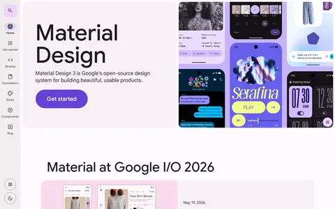</a> 
<b><a href="https://m3.material.io">Material Design 3</a></b> 🆓 
Google's design system with dynamic color and expressive motion.
 <a href="gallery/design-systems.md#m3-material-io">🖼️ View larger</a>
</td>
<td width="33%" valign="top">
<a href="gallery/design-systems.md#developer-apple-com-design-human-interface-guidelines">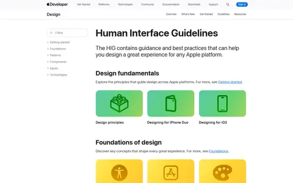</a> 
<b><a href="https://developer.apple.com/design/human-interface-guidelines">Apple Human Interface Guidelines</a></b> 🆓 
Platform design guidance from Apple.
 <a href="gallery/design-systems.md#developer-apple-com-design-human-interface-guidelines">🖼️ View larger</a>
</td>
<td width="33%" valign="top">
<a href="gallery/design-systems.md#fluent2-microsoft-design">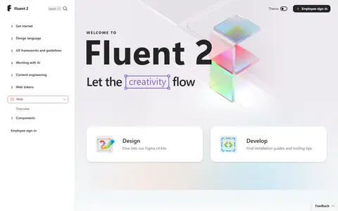</a> 
<b><a href="https://fluent2.microsoft.design">Fluent 2</a></b> 🆓 
Microsoft's cross-platform design system.
 <a href="gallery/design-systems.md#fluent2-microsoft-design">🖼️ View larger</a>
</td>
</tr>
<tr>
<td width="33%" valign="top">
<a href="gallery/design-systems.md#carbondesignsystem-com">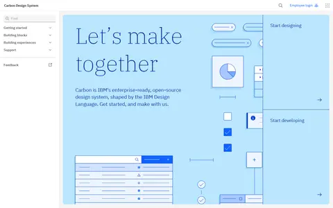</a> 
<b><a href="https://carbondesignsystem.com">Carbon</a></b> 🆓 
IBM's open-source system for products and digital experiences.
 <a href="gallery/design-systems.md#carbondesignsystem-com">🖼️ View larger</a>
</td>
<td width="33%" valign="top">
<a href="gallery/design-systems.md#atlassian-design">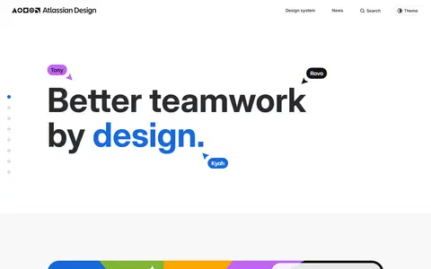</a> 
<b><a href="https://atlassian.design">Atlassian Design System</a></b> 🆓 
Foundations, tokens and components behind Jira and Confluence.
 <a href="gallery/design-systems.md#atlassian-design">🖼️ View larger</a>
</td>
<td width="33%" valign="top">
<a href="gallery/design-systems.md#primer-style">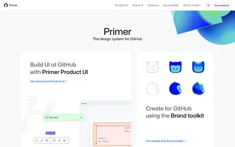</a> 
<b><a href="https://primer.style">Primer</a></b> 🆓 
GitHub's design system.
 <a href="gallery/design-systems.md#primer-style">🖼️ View larger</a>
</td>
</tr>
<tr>
<td width="33%" valign="top">
<a href="gallery/design-systems.md#ant-design">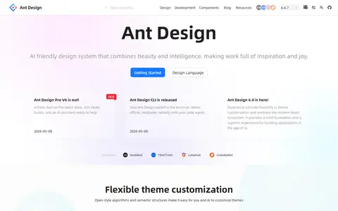</a> 
<b><a href="https://ant.design">Ant Design</a></b> 🆓 
Enterprise-class design language with a large React implementation.
 <a href="gallery/design-systems.md#ant-design">🖼️ View larger</a>
</td>
<td width="33%" valign="top">
<a href="gallery/design-systems.md#spectrum-adobe-com">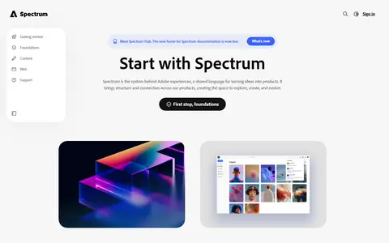</a> 
<b><a href="https://spectrum.adobe.com">Spectrum</a></b> 🆓 
Adobe's design system (React Spectrum, Spectrum Web Components).
 <a href="gallery/design-systems.md#spectrum-adobe-com">🖼️ View larger</a>
</td>
<td width="33%" valign="top">
<a href="gallery/design-systems.md#vercel-com-geist">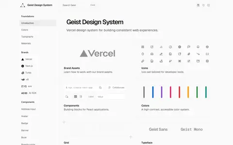</a> 
<b><a href="https://vercel.com/geist">Geist</a></b> 🆓 
Vercel's minimal design system and typeface.
 <a href="gallery/design-systems.md#vercel-com-geist">🖼️ View larger</a>
</td>
</tr>
<tr>
<td width="33%" valign="top">
<a href="gallery/design-systems.md#gestalt-pinterest-systems">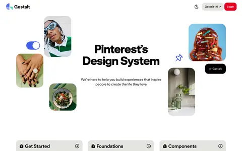</a> 
<b><a href="https://gestalt.pinterest.systems">Gestalt</a></b> 🆓 
Pinterest's design system.
 <a href="gallery/design-systems.md#gestalt-pinterest-systems">🖼️ View larger</a>
</td>
<td width="33%" valign="top">
<a href="gallery/design-systems.md#baseweb-design">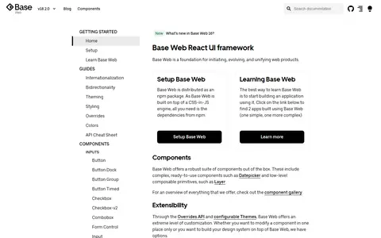</a> 
<b><a href="https://baseweb.design">Base Web</a></b> 🆓 
Uber's design system.
 <a href="gallery/design-systems.md#baseweb-design">🖼️ View larger</a>
</td>
<td width="33%" valign="top">
<a href="gallery/design-systems.md#eui-elastic-co">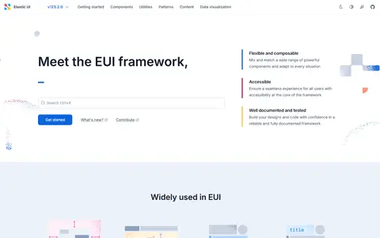</a> 
<b><a href="https://eui.elastic.co">Elastic UI (EUI)</a></b> 🆓 
Elastic's design system for data-rich apps.
 <a href="gallery/design-systems.md#eui-elastic-co">🖼️ View larger</a>
</td>
</tr>
<tr>
<td width="33%" valign="top">
<a href="gallery/design-systems.md#lightningdesignsystem-com">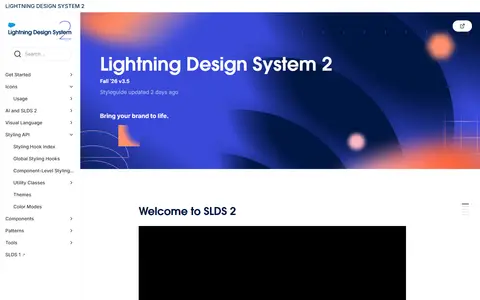</a> 
<b><a href="https://www.lightningdesignsystem.com">Salesforce Lightning</a></b> 🆓 
Enterprise system from Salesforce.
 <a href="gallery/design-systems.md#lightningdesignsystem-com">🖼️ View larger</a>
</td>
<td width="33%" valign="top">
<a href="gallery/design-systems.md#design-system-service-gov-uk">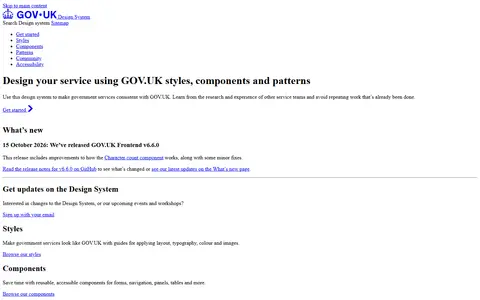</a> 
<b><a href="https://design-system.service.gov.uk">GOV.UK Design System</a></b> 🆓 
Gold standard for accessible public-service UI.
 <a href="gallery/design-systems.md#design-system-service-gov-uk">🖼️ View larger</a>
</td>
<td width="33%" valign="top">
<a href="gallery/design-systems.md#designsystem-digital-gov">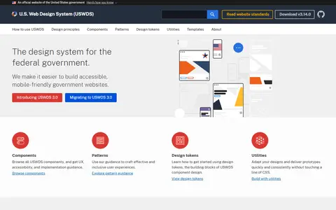</a> 
<b><a href="https://designsystem.digital.gov">U.S. Web Design System</a></b> 🆓 
Accessible components for U.S. government sites.
 <a href="gallery/design-systems.md#designsystem-digital-gov">🖼️ View larger</a>
</td>
</tr>
</table>

[🖼️ Open the Design Systems gallery](gallery/design-systems.md)

---

## Styling Foundations

How you actually write your CSS. Pick one of these first, everything else sits on top.

<table>
<tr>
<td width="33%" valign="top">
<a href="gallery/styling-foundations.md#tailwindcss-com">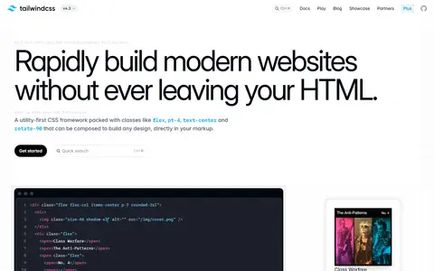</a> 
<b><a href="https://tailwindcss.com">Tailwind CSS</a></b> 🆓🌐 
Utility-first CSS framework; the base layer of most modern kits.
 <a href="gallery/styling-foundations.md#tailwindcss-com">🖼️ View larger</a>
</td>
<td width="33%" valign="top">
<a href="gallery/styling-foundations.md#daisyui-com">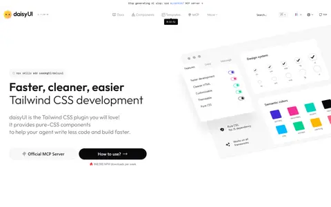</a> 
<b><a href="https://daisyui.com">daisyUI</a></b> 🆓🌐 
Semantic component classes and themes on top of Tailwind.
 <a href="gallery/styling-foundations.md#daisyui-com">🖼️ View larger</a>
</td>
<td width="33%" valign="top">
<a href="gallery/styling-foundations.md#unocss-dev">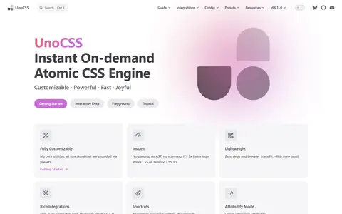</a> 
<b><a href="https://unocss.dev">UnoCSS</a></b> 🆓🌐 
Instant on-demand atomic CSS engine.
 <a href="gallery/styling-foundations.md#unocss-dev">🖼️ View larger</a>
</td>
</tr>
<tr>
<td width="33%" valign="top">
<a href="gallery/styling-foundations.md#panda-css-com">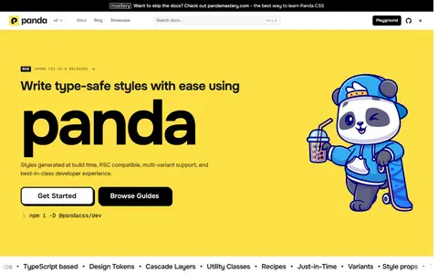</a> 
<b><a href="https://panda-css.com">Panda CSS</a></b> 🆓🌐 
Build-time CSS-in-JS with tokens and recipes.
 <a href="gallery/styling-foundations.md#panda-css-com">🖼️ View larger</a>
</td>
<td width="33%" valign="top">
<a href="gallery/styling-foundations.md#stylexjs-com">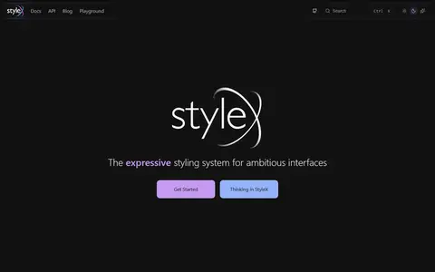</a> 
<b><a href="https://stylexjs.com">StyleX</a></b> 🆓⚛️ 
Meta's compile-time styling system.
 <a href="gallery/styling-foundations.md#stylexjs-com">🖼️ View larger</a>
</td>
<td width="33%" valign="top">
<a href="gallery/styling-foundations.md#vanilla-extract-style">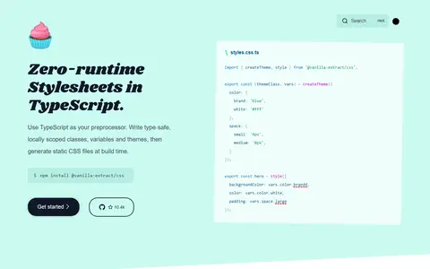</a> 
<b><a href="https://vanilla-extract.style">vanilla-extract</a></b> 🆓🌐 
Zero-runtime, type-safe stylesheets in TypeScript.
 <a href="gallery/styling-foundations.md#vanilla-extract-style">🖼️ View larger</a>
</td>
</tr>
<tr>
<td width="33%" valign="top">
<a href="gallery/styling-foundations.md#open-props-style">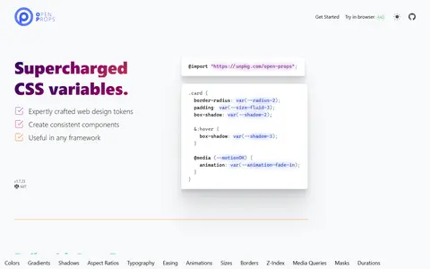</a> 
<b><a href="https://open-props.style">Open Props</a></b> 🆓🌐 
Supercharged CSS custom properties (sizes, easings, shadows).
 <a href="gallery/styling-foundations.md#open-props-style">🖼️ View larger</a>
</td>
<td width="33%" valign="top">
<a href="gallery/styling-foundations.md#picocss-com">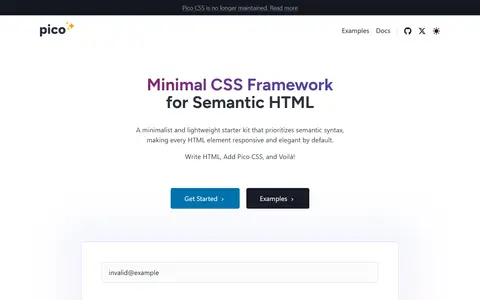</a> 
<b><a href="https://picocss.com">Pico CSS</a></b> 🆓🌐 
Minimal CSS for semantic HTML.
 <a href="gallery/styling-foundations.md#picocss-com">🖼️ View larger</a>
</td>
<td width="33%" valign="top">
<a href="gallery/styling-foundations.md#getbootstrap-com">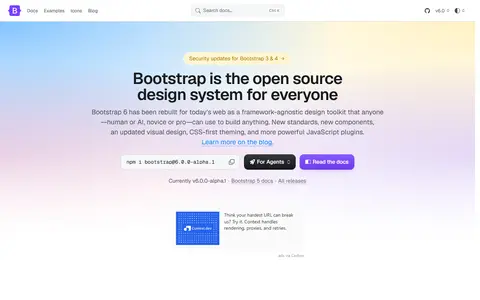</a> 
<b><a href="https://getbootstrap.com">Bootstrap</a></b> 🆓🌐 
The classic responsive component framework.
 <a href="gallery/styling-foundations.md#getbootstrap-com">🖼️ View larger</a>
</td>
</tr>
<tr>
<td width="33%" valign="top">
<a href="gallery/styling-foundations.md#bulma-io">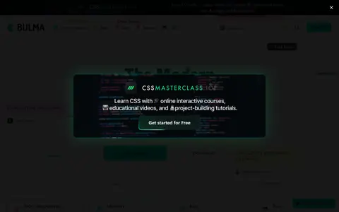</a> 
<b><a href="https://bulma.io">Bulma</a></b> 🆓🌐 
Modern, Flexbox-based CSS framework.
 <a href="gallery/styling-foundations.md#bulma-io">🖼️ View larger</a>
</td>
</tr>
</table>

[🖼️ Open the Styling Foundations gallery](gallery/styling-foundations.md)

---

## Headless Primitives

Accessible components with no styling at all. This is the layer you build your own design system on, and it saves you from getting keyboard and screen reader support wrong.

<table>
<tr>
<td width="33%" valign="top">
<a href="gallery/headless-primitives.md#radix-ui-com-primitives">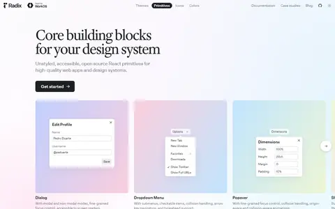</a> 
<b><a href="https://www.radix-ui.com/primitives">Radix Primitives</a></b> 🆓⚛️ 
Accessible unstyled React primitives; the original foundation of shadcn/ui.
 <a href="gallery/headless-primitives.md#radix-ui-com-primitives">🖼️ View larger</a>
</td>
<td width="33%" valign="top">
<a href="gallery/headless-primitives.md#base-ui-com">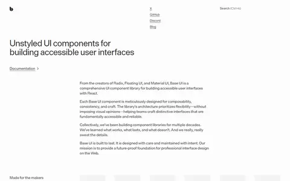</a> 
<b><a href="https://base-ui.com">Base UI</a></b> 🆓⚛️ 
Unstyled components from the creators of Radix, Floating UI and MUI.
 <a href="gallery/headless-primitives.md#base-ui-com">🖼️ View larger</a>
</td>
<td width="33%" valign="top">
<a href="gallery/headless-primitives.md#react-spectrum-adobe-com-react-aria">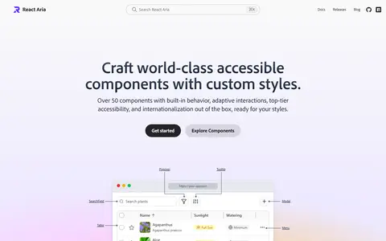</a> 
<b><a href="https://react-spectrum.adobe.com/react-aria/">React Aria</a></b> 🆓⚛️ 
Adobe's hooks and components with best-in-class accessibility and i18n.
 <a href="gallery/headless-primitives.md#react-spectrum-adobe-com-react-aria">🖼️ View larger</a>
</td>
</tr>
<tr>
<td width="33%" valign="top">
<a href="gallery/headless-primitives.md#headlessui-com">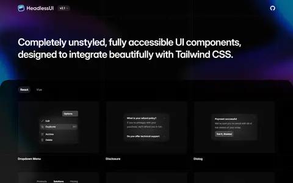</a> 
<b><a href="https://headlessui.com">Headless UI</a></b> 🆓⚛️🟢 
Unstyled components from the Tailwind team (React &amp; Vue).
 <a href="gallery/headless-primitives.md#headlessui-com">🖼️ View larger</a>
</td>
<td width="33%" valign="top">
<a href="gallery/headless-primitives.md#ark-ui-com">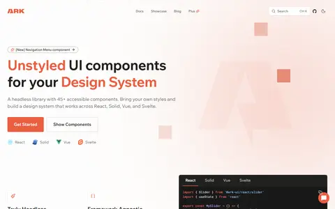</a> 
<b><a href="https://ark-ui.com">Ark UI</a></b> 🆓🌐 
Headless components for React, Vue, Solid and Svelte, powered by Zag.
 <a href="gallery/headless-primitives.md#ark-ui-com">🖼️ View larger</a>
</td>
<td width="33%" valign="top">
<a href="gallery/headless-primitives.md#zagjs-com">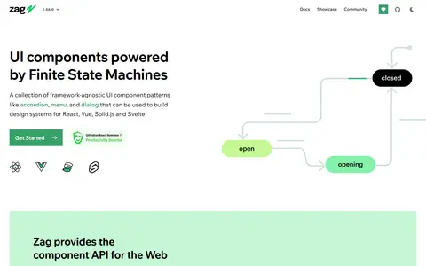</a> 
<b><a href="https://zagjs.com">Zag</a></b> 🆓🌐 
Framework-agnostic UI component state machines.
 <a href="gallery/headless-primitives.md#zagjs-com">🖼️ View larger</a>
</td>
</tr>
<tr>
<td width="33%" valign="top">
<a href="gallery/headless-primitives.md#ariakit-org">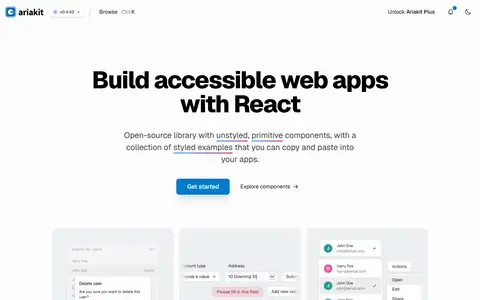</a> 
<b><a href="https://ariakit.org">Ariakit</a></b> 🆓⚛️ 
Lightweight, accessible React primitives.
 <a href="gallery/headless-primitives.md#ariakit-org">🖼️ View larger</a>
</td>
<td width="33%" valign="top">
<a href="gallery/headless-primitives.md#reka-ui-com">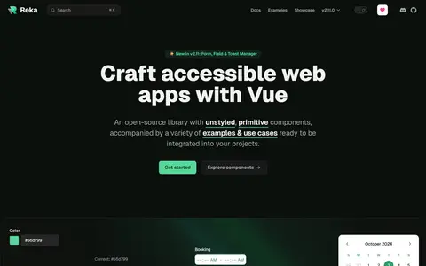</a> 
<b><a href="https://reka-ui.com">Reka UI</a></b> 🆓🟢 
Vue port of the Radix model (formerly Radix Vue).
 <a href="gallery/headless-primitives.md#reka-ui-com">🖼️ View larger</a>
</td>
<td width="33%" valign="top">
<a href="gallery/headless-primitives.md#bits-ui-com">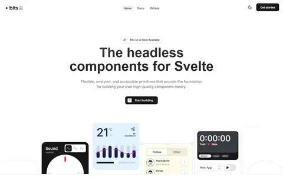</a> 
<b><a href="https://bits-ui.com">Bits UI</a></b> 🆓🧡 
Headless components for Svelte.
 <a href="gallery/headless-primitives.md#bits-ui-com">🖼️ View larger</a>
</td>
</tr>
<tr>
<td width="33%" valign="top">
<a href="gallery/headless-primitives.md#melt-ui-com">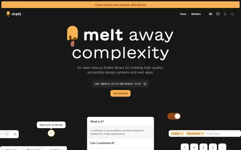</a> 
<b><a href="https://melt-ui.com">Melt UI</a></b> 🆓🧡 
Headless builders for Svelte.
 <a href="gallery/headless-primitives.md#melt-ui-com">🖼️ View larger</a>
</td>
<td width="33%" valign="top">
<a href="gallery/headless-primitives.md#kobalte-dev">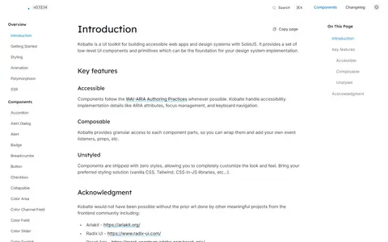</a> 
<b><a href="https://kobalte.dev">Kobalte</a></b> 🆓 
Accessible headless components for SolidJS.
 <a href="gallery/headless-primitives.md#kobalte-dev">🖼️ View larger</a>
</td>
<td width="33%" valign="top">
<a href="gallery/headless-primitives.md#floating-ui-com">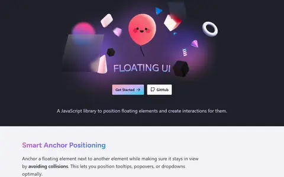</a> 
<b><a href="https://floating-ui.com">Floating UI</a></b> 🆓🌐 
Positioning engine for tooltips, popovers and dropdowns.
 <a href="gallery/headless-primitives.md#floating-ui-com">🖼️ View larger</a>
</td>
</tr>
<tr>
<td width="33%" valign="top">
<a href="gallery/headless-primitives.md#tanstack-com-table">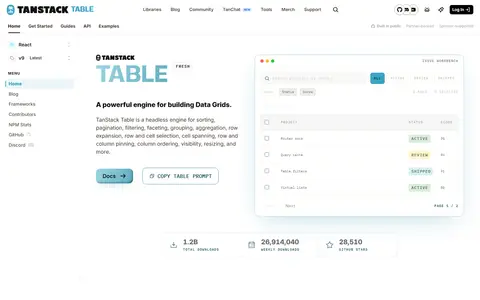</a> 
<b><a href="https://tanstack.com/table">TanStack Table</a> / <a href="https://tanstack.com/virtual">Virtual</a> / <a href="https://tanstack.com/form">Form</a></b> 🆓🌐 
Headless table, virtualization and form logic.
 <a href="gallery/headless-primitives.md#tanstack-com-table">🖼️ View larger</a>
</td>
</tr>
</table>

[🖼️ Open the Headless Primitives gallery](gallery/headless-primitives.md)

---

## Component Libraries

Ready-made components, grouped by framework. This is the biggest section, because there are a lot of good ones.

### React

<table>
<tr>
<td width="33%" valign="top">
<a href="gallery/component-libraries.md#mui-com">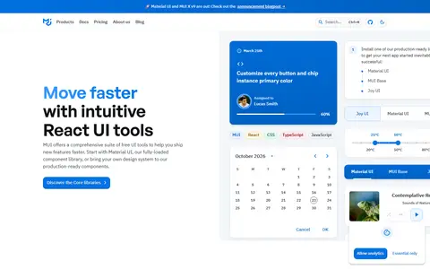</a> 
<b><a href="https://mui.com">MUI (Material UI)</a></b> 🆓💎⚛️ 
Comprehensive Material Design components plus MUI X data grid and pickers.
 <a href="gallery/component-libraries.md#mui-com">🖼️ View larger</a>
</td>
<td width="33%" valign="top">
<a href="gallery/component-libraries.md#mantine-dev">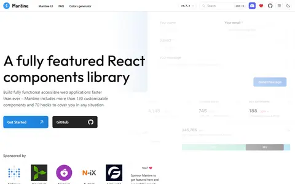</a> 
<b><a href="https://mantine.dev">Mantine</a></b> 🆓⚛️ 
100+ components and hooks with excellent DX.
 <a href="gallery/component-libraries.md#mantine-dev">🖼️ View larger</a>
</td>
<td width="33%" valign="top">
<a href="gallery/component-libraries.md#chakra-ui-com">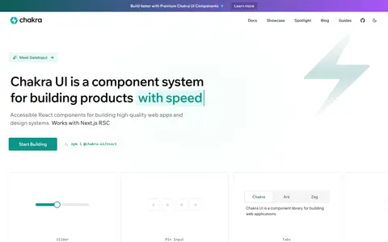</a> 
<b><a href="https://chakra-ui.com">Chakra UI</a></b> 🆓⚛️ 
Accessible, themeable components (v3 built on Ark UI).
 <a href="gallery/component-libraries.md#chakra-ui-com">🖼️ View larger</a>
</td>
</tr>
<tr>
<td width="33%" valign="top">
<a href="gallery/component-libraries.md#heroui-com">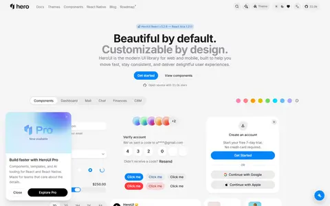</a> 
<b><a href="https://heroui.com">HeroUI</a></b> 🆓⚛️ 
Beautiful Tailwind-based components (formerly NextUI).
 <a href="gallery/component-libraries.md#heroui-com">🖼️ View larger</a>
</td>
<td width="33%" valign="top">
 
<b><a href="https://ant.design">Ant Design</a></b> 🆓⚛️ 
Enterprise component suite.
 <a href="gallery/component-libraries.md#ant-design">🖼️ View larger</a>
</td>
<td width="33%" valign="top">
<a href="gallery/component-libraries.md#react-spectrum-adobe-com">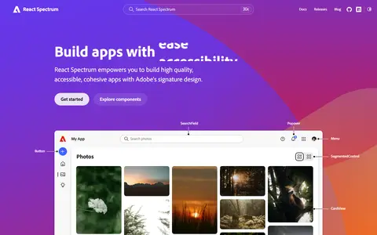</a> 
<b><a href="https://react-spectrum.adobe.com">React Spectrum</a></b> 🆓⚛️ 
Adobe's styled implementation of Spectrum.
 <a href="gallery/component-libraries.md#react-spectrum-adobe-com">🖼️ View larger</a>
</td>
</tr>
<tr>
<td width="33%" valign="top">
<a href="gallery/component-libraries.md#react-fluentui-dev">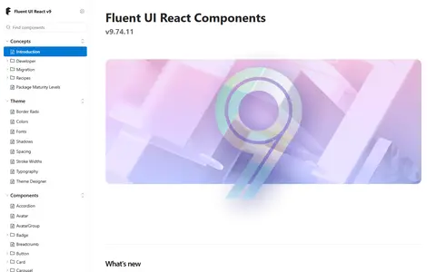</a> 
<b><a href="https://react.fluentui.dev">Fluent UI React</a></b> 🆓⚛️ 
Microsoft's Fluent 2 components.
 <a href="gallery/component-libraries.md#react-fluentui-dev">🖼️ View larger</a>
</td>
<td width="33%" valign="top">
<a href="gallery/component-libraries.md#blueprintjs-com">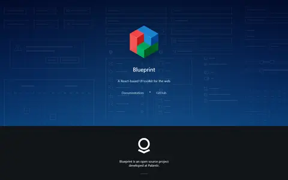</a> 
<b><a href="https://blueprintjs.com">Blueprint</a></b> 🆓⚛️ 
Toolkit for complex, data-dense desktop-style apps.
 <a href="gallery/component-libraries.md#blueprintjs-com">🖼️ View larger</a>
</td>
<td width="33%" valign="top">
<a href="gallery/component-libraries.md#primereact-org">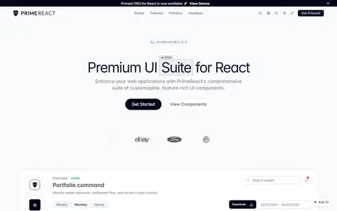</a> 
<b><a href="https://primereact.org">PrimeReact</a></b> 🆓💎⚛️ 
90+ components with themes and a styled/unstyled mode.
 <a href="gallery/component-libraries.md#primereact-org">🖼️ View larger</a>
</td>
</tr>
<tr>
<td width="33%" valign="top">
<a href="gallery/component-libraries.md#park-ui-com">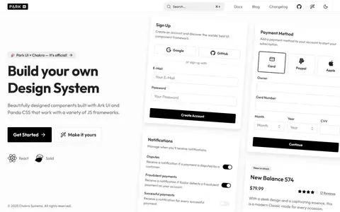</a> 
<b><a href="https://park-ui.com">Park UI</a></b> 🆓⚛️ 
Styled components built on Ark UI and Panda/Tailwind.
 <a href="gallery/component-libraries.md#park-ui-com">🖼️ View larger</a>
</td>
<td width="33%" valign="top">
<a href="gallery/component-libraries.md#tremor-so">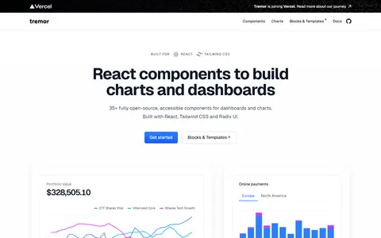</a> 
<b><a href="https://tremor.so">Tremor</a></b> 🆓⚛️ 
Components for dashboards and analytics.
 <a href="gallery/component-libraries.md#tremor-so">🖼️ View larger</a>
</td>
<td width="33%" valign="top">
<a href="gallery/component-libraries.md#untitledui-com-react">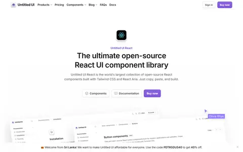</a> 
<b><a href="https://www.untitledui.com/react">Untitled UI React</a></b> 🆓💎⚛️ 
Large Figma kit with matching React components.
 <a href="gallery/component-libraries.md#untitledui-com-react">🖼️ View larger</a>
</td>
</tr>
</table>

### Copy-Paste & Registries (shadcn ecosystem)

You don't install these, you copy the code into your project and it's yours to change.

<table>
<tr>
<td width="33%" valign="top">
<a href="gallery/component-libraries.md#ui-shadcn-com">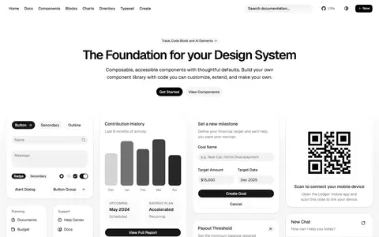</a> 
<b><a href="https://ui.shadcn.com">shadcn/ui</a></b> 🆓⚛️ 
The copy-paste standard; Tailwind + Radix or Base UI, with a registry/CLI ecosystem.
 <a href="gallery/component-libraries.md#ui-shadcn-com">🖼️ 3 references</a>
</td>
<td width="33%" valign="top">
 
<b><a href="https://www.kibo-ui.com">Kibo UI</a></b> 🆓⚛️ 
Advanced composable shadcn components (kanban, gantt, editor…).
 <a href="gallery/component-libraries.md#kibo-ui-com">🖼️ View larger</a>
</td>
<td width="33%" valign="top">
 
<b><a href="https://www.cult-ui.com">Cult UI</a></b> 🆓⚛️ 
Stylish shadcn-compatible components and blocks.
 <a href="gallery/component-libraries.md#cult-ui-com">🖼️ View larger</a>
</td>
</tr>
<tr>
<td width="33%" valign="top">
 
<b><a href="https://originui.com">Origin UI</a></b> 🆓⚛️ 
Large collection of shadcn-style components.
 <a href="gallery/component-libraries.md#originui-com">🖼️ View larger</a>
</td>
<td width="33%" valign="top">
 
<b><a href="https://21st.dev">21st.dev</a></b> 🆓⚛️ 
Community registry of shadcn-compatible components.
 <a href="gallery/component-libraries.md#21st-dev">🖼️ View larger</a>
</td>
<td width="33%" valign="top">
 
<b><a href="https://tweakcn.com">tweakcn</a></b> 🆓⚛️ 
Visual theme editor for shadcn/ui.
 <a href="gallery/component-libraries.md#tweakcn-com">🖼️ View larger</a>
</td>
</tr>
<tr>
<td width="33%" valign="top">
<b><a href="https://tailwindcss.com/plus">Tailwind Plus</a></b> 💎⚛️🟢 
Official Tailwind UI blocks, templates and Catalyst kit.
</td>
<td width="33%" valign="top">
 
<b><a href="https://flowbite.com">Flowbite</a></b> 🆓💎🌐 
Tailwind components with React, Vue, Svelte and Angular ports.
 <a href="gallery/component-libraries.md#flowbite-com">🖼️ View larger</a>
</td>
<td width="33%" valign="top">
 
<b><a href="https://preline.co">Preline UI</a></b> 🆓💎🌐 
Open-source Tailwind components and blocks.
 <a href="gallery/component-libraries.md#preline-co">🖼️ View larger</a>
</td>
</tr>
<tr>
<td width="33%" valign="top">
 
<b><a href="https://www.hyperui.dev">HyperUI</a></b> 🆓🌐 
Free Tailwind component snippets.
 <a href="gallery/component-libraries.md#hyperui-dev">🖼️ View larger</a>
</td>
</tr>
</table>

### Animated Component Collections

Components that are mostly about the animation. Great for landing pages, easy to overdo.

<table>
<tr>
<td width="33%" valign="top">
 
<b><a href="https://magicui.design">Magic UI</a></b> 🆓💎⚛️ 
150+ animated components (marquees, bento grids, shimmer buttons) for shadcn projects.
 <a href="gallery/component-libraries.md#magicui-design">🖼️ 2 references</a>
</td>
<td width="33%" valign="top">
 
<b><a href="https://ui.aceternity.com">Aceternity UI</a></b> 🆓💎⚛️ 
Dramatic effects: 3D cards, spotlights, animated backgrounds.
 <a href="gallery/component-libraries.md#ui-aceternity-com">🖼️ 2 references</a>
</td>
<td width="33%" valign="top">
 
<b><a href="https://reactbits.dev">React Bits</a></b> 🆓⚛️ 
110+ animated text, background and interactive components; no single engine lock-in.
 <a href="gallery/component-libraries.md#reactbits-dev">🖼️ 2 references</a>
</td>
</tr>
<tr>
<td width="33%" valign="top">
 
<b><a href="https://motion-primitives.com">Motion Primitives</a></b> 🆓⚛️ 
Animated building blocks built on Motion.
 <a href="gallery/component-libraries.md#motion-primitives-com">🖼️ View larger</a>
</td>
<td width="33%" valign="top">
 
<b><a href="https://animate-ui.com">Animate UI</a></b> 🆓⚛️ 
Animated shadcn-style components.
 <a href="gallery/component-libraries.md#animate-ui-com">🖼️ View larger</a>
</td>
<td width="33%" valign="top">
 
<b><a href="https://animata.design">Animata</a></b> 🆓⚛️ 
Hand-crafted interaction animations.
 <a href="gallery/component-libraries.md#animata-design">🖼️ View larger</a>
</td>
</tr>
<tr>
<td width="33%" valign="top">
 
<b><a href="https://www.eldoraui.site">Eldora UI</a></b> 🆓⚛️ 
Free animated component set.
 <a href="gallery/component-libraries.md#eldoraui-site">🖼️ View larger</a>
</td>
<td width="33%" valign="top">
 
<b><a href="https://kokonutui.com">Kokonut UI</a></b> 🆓💎⚛️ 
Modern animated components and blocks.
 <a href="gallery/component-libraries.md#kokonutui-com">🖼️ View larger</a>
</td>
<td width="33%" valign="top">
 
<b><a href="https://skiper-ui.com">Skiper UI</a></b> 🆓💎⚛️ 
Polished interaction components.
 <a href="gallery/component-libraries.md#skiper-ui-com">🖼️ View larger</a>
</td>
</tr>
<tr>
<td width="33%" valign="top">
 
<b><a href="https://inspira-ui.com">Inspira UI</a></b> 🆓🟢 
Animated components for Vue/Nuxt.
 <a href="gallery/component-libraries.md#inspira-ui-com">🖼️ View larger</a>
</td>
<td width="33%" valign="top">
 
<b><a href="https://uiverse.io">Uiverse</a></b> 🆓🌐 
Community-made pure CSS/Tailwind elements.
 <a href="gallery/component-libraries.md#uiverse-io">🖼️ View larger</a>
</td>
</tr>
</table>

### Vue

<table>
<tr>
<td width="33%" valign="top">
 
<b><a href="https://ui.nuxt.com">Nuxt UI</a></b> 🆓🟢 
Tailwind + Reka UI components for Vue and Nuxt.
 <a href="gallery/component-libraries.md#ui-nuxt-com">🖼️ View larger</a>
</td>
<td width="33%" valign="top">
 
<b><a href="https://www.shadcn-vue.com">shadcn-vue</a></b> 🆓🟢 
Vue port of shadcn/ui.
 <a href="gallery/component-libraries.md#shadcn-vue-com">🖼️ View larger</a>
</td>
<td width="33%" valign="top">
 
<b><a href="https://vuetifyjs.com">Vuetify</a></b> 🆓🟢 
Material Design component framework.
 <a href="gallery/component-libraries.md#vuetifyjs-com">🖼️ View larger</a>
</td>
</tr>
<tr>
<td width="33%" valign="top">
 
<b><a href="https://primevue.org">PrimeVue</a></b> 🆓🟢 
Rich component suite with styled/unstyled modes.
 <a href="gallery/component-libraries.md#primevue-org">🖼️ View larger</a>
</td>
<td width="33%" valign="top">
 
<b><a href="https://www.naiveui.com">Naive UI</a></b> 🆓🟢 
Themeable TypeScript components.
 <a href="gallery/component-libraries.md#naiveui-com">🖼️ View larger</a>
</td>
<td width="33%" valign="top">
 
<b><a href="https://element-plus.org">Element Plus</a></b> 🆓🟢 
Vue 3 desktop UI library.
 <a href="gallery/component-libraries.md#element-plus-org">🖼️ View larger</a>
</td>
</tr>
<tr>
<td width="33%" valign="top">
 
<b><a href="https://quasar.dev">Quasar</a></b> 🆓🟢 
Build web, mobile and desktop from one Vue codebase.
 <a href="gallery/component-libraries.md#quasar-dev">🖼️ View larger</a>
</td>
</tr>
</table>

### Svelte

<table>
<tr>
<td width="33%" valign="top">
 
<b><a href="https://www.shadcn-svelte.com">shadcn-svelte</a></b> 🆓🧡 
Svelte port of shadcn/ui built on Bits UI.
 <a href="gallery/component-libraries.md#shadcn-svelte-com">🖼️ View larger</a>
</td>
<td width="33%" valign="top">
 
<b><a href="https://www.skeleton.dev">Skeleton</a></b> 🆓🧡 
Adaptive design system for Svelte + Tailwind.
 <a href="gallery/component-libraries.md#skeleton-dev">🖼️ View larger</a>
</td>
<td width="33%" valign="top">
<b><a href="https://flowbite-svelte.com">Flowbite Svelte</a></b> 🆓🧡 
Flowbite components for Svelte.
</td>
</tr>
</table>

### Angular

<table>
<tr>
<td width="33%" valign="top">
 
<b><a href="https://material.angular.dev">Angular Material</a></b> 🆓🅰️ 
Official Material components and CDK.
 <a href="gallery/component-libraries.md#material-angular-dev">🖼️ View larger</a>
</td>
<td width="33%" valign="top">
 
<b><a href="https://www.spartan.ng">Spartan</a></b> 🆓🅰️ 
shadcn-style copy-paste components for Angular.
 <a href="gallery/component-libraries.md#spartan-ng">🖼️ View larger</a>
</td>
<td width="33%" valign="top">
 
<b><a href="https://primeng.org">PrimeNG</a></b> 🆓🅰️ 
Large Angular component suite.
 <a href="gallery/component-libraries.md#primeng-org">🖼️ View larger</a>
</td>
</tr>
<tr>
<td width="33%" valign="top">
 
<b><a href="https://ng.ant.design">NG-ZORRO</a></b> 🆓🅰️ 
Ant Design for Angular.
 <a href="gallery/component-libraries.md#ng-ant-design">🖼️ View larger</a>
</td>
<td width="33%" valign="top">
 
<b><a href="https://taiga-ui.dev">Taiga UI</a></b> 🆓🅰️ 
Modular Angular UI kit.
 <a href="gallery/component-libraries.md#taiga-ui-dev">🖼️ View larger</a>
</td>
</tr>
</table>

### Solid

<table>
<tr>
<td width="33%" valign="top">
 
<b><a href="https://kobalte.dev">Kobalte</a></b>  
Headless primitives (see above).
 <a href="gallery/component-libraries.md#kobalte-dev">🖼️ View larger</a>
</td>
<td width="33%" valign="top">
 
<b><a href="https://ark-ui.com">Ark UI for Solid</a></b> 🆓 
Headless components with Solid bindings.
 <a href="gallery/component-libraries.md#ark-ui-com">🖼️ View larger</a>
</td>
</tr>
</table>

### Web Components

<table>
<tr>
<td width="33%" valign="top">
 
<b><a href="https://webawesome.com">Web Awesome</a></b> 🆓💎🌐 
Successor to Shoelace; framework-agnostic components.
 <a href="gallery/component-libraries.md#webawesome-com">🖼️ View larger</a>
</td>
<td width="33%" valign="top">
 
<b><a href="https://lit.dev">Lit</a></b> 🆓🌐 
Simple, fast library for building web components.
 <a href="gallery/component-libraries.md#lit-dev">🖼️ View larger</a>
</td>
<td width="33%" valign="top">
 
<b><a href="https://opensource.adobe.com/spectrum-web-components/">Spectrum Web Components</a></b> 🆓🌐 
Adobe Spectrum as web components.
 <a href="gallery/component-libraries.md#opensource-adobe-com-spectrum-web-components">🖼️ View larger</a>
</td>
</tr>
<tr>
<td width="33%" valign="top">
 
<b><a href="https://ionicframework.com">Ionic</a></b> 🆓🌐 
Mobile-first UI components for the web.
 <a href="gallery/component-libraries.md#ionicframework-com">🖼️ View larger</a>
</td>
</tr>
</table>

[🖼️ Open the Component Libraries gallery](gallery/component-libraries.md)

---

## Motion & Animation

For when things need to move. Most projects only need one animation engine, so don't install three.

### Animation Engines

<table>
<tr>
<td width="33%" valign="top">
 
<b><a href="https://motion.dev">Motion</a></b> 🆓🌐 
Formerly Framer Motion; hybrid WAAPI/JS engine for React, Vue and vanilla JS (layout, gestures, springs).
 <a href="gallery/motion-animation.md#motion-dev">🖼️ View larger</a>
</td>
<td width="33%" valign="top">
 
<b><a href="https://gsap.com">GSAP</a></b> 🆓🌐 
Industry-standard timeline engine; all plugins (ScrollTrigger, SplitText, MorphSVG, Flip) now free.
 <a href="gallery/motion-animation.md#gsap-com">🖼️ 2 references</a>
</td>
<td width="33%" valign="top">
 
<b><a href="https://animejs.com">Anime.js</a></b> 🆓🌐 
Lightweight, modular engine with timelines, draggables and scroll observers.
 <a href="gallery/motion-animation.md#animejs-com">🖼️ View larger</a>
</td>
</tr>
<tr>
<td width="33%" valign="top">
 
<b><a href="https://www.react-spring.dev">React Spring</a></b> 🆓⚛️ 
Spring-physics animation for React.
 <a href="gallery/motion-animation.md#react-spring-dev">🖼️ View larger</a>
</td>
<td width="33%" valign="top">
 
<b><a href="https://auto-animate.formkit.com">AutoAnimate</a></b> 🆓🌐 
Zero-config, drop-in list/layout animations.
 <a href="gallery/motion-animation.md#auto-animate-formkit-com">🖼️ View larger</a>
</td>
<td width="33%" valign="top">
 
<b><a href="https://www.theatrejs.com">Theatre.js</a></b> 🆓🌐 
Visual timeline editor for motion design in code (great with Three.js).
 <a href="gallery/motion-animation.md#theatrejs-com">🖼️ View larger</a>
</td>
</tr>
<tr>
<td width="33%" valign="top">
 
<b><a href="https://svelte.dev/docs/svelte/transition">Svelte Motion &amp; Transitions</a></b> 🆓🧡 
Built-in Svelte transitions, tweens and springs.
 <a href="gallery/motion-animation.md#svelte-dev-docs-svelte-transition">🖼️ View larger</a>
</td>
<td width="33%" valign="top">
 
<b><a href="https://motion.dev/docs/vue">Motion for Vue</a></b> 🆓🟢 
Motion's Vue API.
 <a href="gallery/motion-animation.md#motion-dev-docs-vue">🖼️ View larger</a>
</td>
</tr>
</table>

### Scroll & Smooth Scrolling

<table>
<tr>
<td width="33%" valign="top">
 
<b><a href="https://gsap.com/docs/v3/Plugins/ScrollTrigger/">GSAP ScrollTrigger</a></b> 🆓🌐 
Scroll-linked and pinned animations.
 <a href="gallery/motion-animation.md#gsap-com-docs-v3-plugins-scrolltrigger">🖼️ View larger</a>
</td>
<td width="33%" valign="top">
 
<b><a href="https://lenis.darkroom.engineering">Lenis</a></b> 🆓🌐 
Lightweight smooth scrolling.
 <a href="gallery/motion-animation.md#lenis-darkroom-engineering">🖼️ View larger</a>
</td>
<td width="33%" valign="top">
 
<b><a href="https://scroll.locomotive.ca">Locomotive Scroll</a></b> 🆓🌐 
Scroll detection with parallax.
 <a href="gallery/motion-animation.md#scroll-locomotive-ca">🖼️ View larger</a>
</td>
</tr>
<tr>
<td width="33%" valign="top">
 
<b><a href="https://michalsnik.github.io/aos/">AOS</a></b> 🆓🌐 
Animate-on-scroll classic.
 <a href="gallery/motion-animation.md#michalsnik-github-io-aos">🖼️ View larger</a>
</td>
</tr>
</table>

### Page & Route Transitions

<table>
<tr>
<td width="33%" valign="top">
<b><a href="https://developer.mozilla.org/en-US/docs/Web/API/View_Transition_API">View Transitions API</a></b> 🆓🌐 
Native animated transitions between DOM states and pages.
</td>
<td width="33%" valign="top">
 
<b><a href="https://barba.js.org">Barba.js</a></b> 🆓🌐 
Fluid transitions for multi-page sites.
 <a href="gallery/motion-animation.md#barba-js-org">🖼️ View larger</a>
</td>
<td width="33%" valign="top">
 
<b><a href="https://swup.js.org">Swup</a></b> 🆓🌐 
Page transition library with plugins.
 <a href="gallery/motion-animation.md#swup-js-org">🖼️ View larger</a>
</td>
</tr>
</table>

### Designer-Authored Animation

<table>
<tr>
<td width="33%" valign="top">
 
<b><a href="https://rive.app">Rive</a></b> 🆓💎🌐 
Interactive, state-machine-driven vector animations with tiny runtimes.
 <a href="gallery/motion-animation.md#rive-app">🖼️ View larger</a>
</td>
<td width="33%" valign="top">
 
<b><a href="https://airbnb.io/lottie/">Lottie</a></b> 🆓🌐 
Render After Effects animations exported as JSON.
 <a href="gallery/motion-animation.md#airbnb-io-lottie">🖼️ View larger</a>
</td>
<td width="33%" valign="top">
 
<b><a href="https://lottiefiles.com">LottieFiles</a></b> 🆓💎🌐 
Lottie tooling, marketplace and dotLottie players.
 <a href="gallery/motion-animation.md#lottiefiles-com">🖼️ View larger</a>
</td>
</tr>
<tr>
<td width="33%" valign="top">
 
<b><a href="https://spline.design">Spline</a></b> 🆓💎🌐 
Collaborative 3D design tool with web embeds.
 <a href="gallery/motion-animation.md#spline-design">🖼️ View larger</a>
</td>
<td width="33%" valign="top">
 
<b><a href="https://www.unicorn.studio">Unicorn Studio</a></b> 🆓💎🌐 
No-code WebGL effects and backgrounds.
 <a href="gallery/motion-animation.md#unicorn-studio">🖼️ View larger</a>
</td>
</tr>
</table>

### Text & Number Effects

<table>
<tr>
<td width="33%" valign="top">
 
<b><a href="https://gsap.com/docs/v3/Plugins/SplitText/">GSAP SplitText</a></b> 🆓🌐 
Split text into chars/words/lines for animation.
 <a href="gallery/motion-animation.md#gsap-com-docs-v3-plugins-splittext">🖼️ View larger</a>
</td>
<td width="33%" valign="top">
 
<b><a href="https://splitting.js.org">Splitting.js</a></b> 🆓🌐 
CSS-variable-based text splitting.
 <a href="gallery/motion-animation.md#splitting-js-org">🖼️ View larger</a>
</td>
<td width="33%" valign="top">
 
<b><a href="https://number-flow.barvian.me">NumberFlow</a></b> 🆓🌐 
Animated number transitions.
 <a href="gallery/motion-animation.md#number-flow-barvian-me">🖼️ View larger</a>
</td>
</tr>
<tr>
<td width="33%" valign="top">
 
<b><a href="https://github.com/mattboldt/typed.js">Typed.js</a></b> 🆓🌐 
Typewriter effect.
 <a href="gallery/motion-animation.md#github-com-mattboldt-typed-js">🖼️ View larger</a>
</td>
</tr>
</table>

### Carousels & Gestures

<table>
<tr>
<td width="33%" valign="top">
 
<b><a href="https://www.embla-carousel.com">Embla Carousel</a></b> 🆓🌐 
Lightweight, extensible carousel engine.
 <a href="gallery/motion-animation.md#embla-carousel-com">🖼️ View larger</a>
</td>
<td width="33%" valign="top">
 
<b><a href="https://swiperjs.com">Swiper</a></b> 🆓🌐 
Touch slider with many effects.
 <a href="gallery/motion-animation.md#swiperjs-com">🖼️ View larger</a>
</td>
<td width="33%" valign="top">
 
<b><a href="https://use-gesture.netlify.app">@use-gesture</a></b> 🆓⚛️ 
Drag, pinch, scroll and hover gestures.
 <a href="gallery/motion-animation.md#use-gesture-netlify-app">🖼️ View larger</a>
</td>
</tr>
</table>

[🖼️ Open the Motion & Animation gallery](gallery/motion-animation.md)

---

## 3D, WebGL & Creative Coding

The fun stuff. Expect a learning curve.

<table>
<tr>
<td width="33%" valign="top">
 
<b><a href="https://threejs.org">Three.js</a></b> 🆓🌐 
The standard 3D library for the web (WebGL &amp; WebGPU).
 <a href="gallery/3d-webgl-creative-coding.md#threejs-org">🖼️ 2 references</a>
</td>
<td width="33%" valign="top">
 
<b><a href="https://r3f.docs.pmnd.rs">React Three Fiber</a></b> 🆓⚛️ 
React renderer for Three.js.
 <a href="gallery/3d-webgl-creative-coding.md#r3f-docs-pmnd-rs">🖼️ View larger</a>
</td>
<td width="33%" valign="top">
 
<b><a href="https://drei.docs.pmnd.rs">Drei</a></b> 🆓⚛️ 
Helpers and abstractions for R3F.
 <a href="gallery/3d-webgl-creative-coding.md#drei-docs-pmnd-rs">🖼️ View larger</a>
</td>
</tr>
<tr>
<td width="33%" valign="top">
 
<b><a href="https://tresjs.org">TresJS</a></b> 🆓🟢 
Declarative Three.js for Vue.
 <a href="gallery/3d-webgl-creative-coding.md#tresjs-org">🖼️ View larger</a>
</td>
<td width="33%" valign="top">
 
<b><a href="https://threlte.xyz">Threlte</a></b> 🆓🧡 
Three.js for Svelte.
 <a href="gallery/3d-webgl-creative-coding.md#threlte-xyz">🖼️ View larger</a>
</td>
<td width="33%" valign="top">
 
<b><a href="https://www.babylonjs.com">Babylon.js</a></b> 🆓🌐 
Full-featured 3D engine.
 <a href="gallery/3d-webgl-creative-coding.md#babylonjs-com">🖼️ View larger</a>
</td>
</tr>
<tr>
<td width="33%" valign="top">
 
<b><a href="https://playcanvas.com">PlayCanvas</a></b> 🆓💎🌐 
WebGL/WebGPU engine and editor.
 <a href="gallery/3d-webgl-creative-coding.md#playcanvas-com">🖼️ View larger</a>
</td>
<td width="33%" valign="top">
 
<b><a href="https://github.com/oframe/ogl">OGL</a></b> 🆓🌐 
Minimal WebGL library.
 <a href="gallery/3d-webgl-creative-coding.md#github-com-oframe-ogl">🖼️ View larger</a>
</td>
<td width="33%" valign="top">
 
<b><a href="https://pixijs.com">PixiJS</a></b> 🆓🌐 
Fast 2D renderer for interactive graphics.
 <a href="gallery/3d-webgl-creative-coding.md#pixijs-com">🖼️ View larger</a>
</td>
</tr>
<tr>
<td width="33%" valign="top">
 
<b><a href="https://p5js.org">p5.js</a></b> 🆓🌐 
Creative coding for artists and designers.
 <a href="gallery/3d-webgl-creative-coding.md#p5js-org">🖼️ View larger</a>
</td>
<td width="33%" valign="top">
 
<b><a href="https://brm.io/matter-js/">Matter.js</a></b> 🆓🌐 
2D physics engine.
 <a href="gallery/3d-webgl-creative-coding.md#brm-io-matter-js">🖼️ View larger</a>
</td>
<td width="33%" valign="top">
 
<b><a href="https://roughjs.com">Rough.js</a></b> 🆓🌐 
Hand-drawn, sketchy graphics.
 <a href="gallery/3d-webgl-creative-coding.md#roughjs-com">🖼️ View larger</a>
</td>
</tr>
</table>

[🖼️ Open the 3D, WebGL & Creative Coding gallery](gallery/3d-webgl-creative-coding.md)

---

## Charts & Data Visualization

From "I need a bar chart by Friday" to fully custom visualizations.

<table>
<tr>
<td width="33%" valign="top">
 
<b><a href="https://recharts.org">Recharts</a></b> 🆓⚛️ 
Composable React charts (powers shadcn charts).
 <a href="gallery/charts-data-visualization.md#recharts-org">🖼️ View larger</a>
</td>
<td width="33%" valign="top">
 
<b><a href="https://echarts.apache.org">Apache ECharts</a></b> 🆓🌐 
Powerful, interactive charting.
 <a href="gallery/charts-data-visualization.md#echarts-apache-org">🖼️ View larger</a>
</td>
<td width="33%" valign="top">
 
<b><a href="https://d3js.org">D3</a></b> 🆓🌐 
Low-level data visualization toolkit.
 <a href="gallery/charts-data-visualization.md#d3js-org">🖼️ View larger</a>
</td>
</tr>
<tr>
<td width="33%" valign="top">
<b><a href="https://observablehq.com/plot/">Observable Plot</a></b> 🆓🌐 
Concise exploratory charts.
</td>
<td width="33%" valign="top">
 
<b><a href="https://airbnb.io/visx">visx</a></b> 🆓⚛️ 
Low-level React visualization primitives.
 <a href="gallery/charts-data-visualization.md#airbnb-io-visx">🖼️ View larger</a>
</td>
<td width="33%" valign="top">
 
<b><a href="https://nivo.rocks">Nivo</a></b> 🆓⚛️ 
Rich React chart components.
 <a href="gallery/charts-data-visualization.md#nivo-rocks">🖼️ View larger</a>
</td>
</tr>
<tr>
<td width="33%" valign="top">
 
<b><a href="https://www.chartjs.org">Chart.js</a></b> 🆓🌐 
Simple canvas charts.
 <a href="gallery/charts-data-visualization.md#chartjs-org">🖼️ View larger</a>
</td>
<td width="33%" valign="top">
 
<b><a href="https://reactflow.dev">React Flow</a></b> 🆓💎⚛️🧡 
Node-based UIs, diagrams and editors.
 <a href="gallery/charts-data-visualization.md#reactflow-dev">🖼️ View larger</a>
</td>
</tr>
</table>

[🖼️ Open the Charts & Data Visualization gallery](gallery/charts-data-visualization.md)

---

## Icons

Pick one set and stick with it. Mixing icon sets is the fastest way to make a UI look off.

<table>
<tr>
<td width="33%" valign="top">
 
<b><a href="https://lucide.dev">Lucide</a></b> 🆓🌐 
Clean, consistent open-source icons (shadcn default).
 <a href="gallery/icons.md#lucide-dev">🖼️ View larger</a>
</td>
<td width="33%" valign="top">
 
<b><a href="https://heroicons.com">Heroicons</a></b> 🆓🌐 
From the Tailwind team.
 <a href="gallery/icons.md#heroicons-com">🖼️ View larger</a>
</td>
<td width="33%" valign="top">
 
<b><a href="https://phosphoricons.com">Phosphor</a></b> 🆓🌐 
Flexible family with six weights.
 <a href="gallery/icons.md#phosphoricons-com">🖼️ View larger</a>
</td>
</tr>
<tr>
<td width="33%" valign="top">
 
<b><a href="https://tabler.io/icons">Tabler Icons</a></b> 🆓🌐 
5000+ stroke icons.
 <a href="gallery/icons.md#tabler-io-icons">🖼️ View larger</a>
</td>
<td width="33%" valign="top">
 
<b><a href="https://fonts.google.com/icons">Material Symbols</a></b> 🆓🌐 
Google's variable icon font.
 <a href="gallery/icons.md#fonts-google-com-icons">🖼️ View larger</a>
</td>
<td width="33%" valign="top">
 
<b><a href="https://hugeicons.com">Hugeicons</a></b> 🆓💎🌐 
Large icon set with free tier.
 <a href="gallery/icons.md#hugeicons-com">🖼️ View larger</a>
</td>
</tr>
<tr>
<td width="33%" valign="top">
 
<b><a href="https://iconify.design">Iconify</a></b> 🆓🌐 
One API for 200k+ icons from many sets.
 <a href="gallery/icons.md#iconify-design">🖼️ View larger</a>
</td>
</tr>
</table>

[🖼️ Open the Icons gallery](gallery/icons.md)

---

## Fonts

Where I go to find and load fonts.

<table>
<tr>
<td width="33%" valign="top">
 
<b><a href="https://fonts.google.com">Google Fonts</a></b> 🆓 
Free web fonts.
 <a href="gallery/fonts.md#fonts-google-com">🖼️ View larger</a>
</td>
<td width="33%" valign="top">
 
<b><a href="https://fontsource.org">Fontsource</a></b> 🆓 
Self-host open-source fonts via npm.
 <a href="gallery/fonts.md#fontsource-org">🖼️ View larger</a>
</td>
<td width="33%" valign="top">
 
<b><a href="https://rsms.me/inter/">Inter</a></b> 🆓 
Typeface designed for screens.
 <a href="gallery/fonts.md#rsms-me-inter">🖼️ View larger</a>
</td>
</tr>
<tr>
<td width="33%" valign="top">
 
<b><a href="https://vercel.com/font">Geist</a></b> 🆓 
Vercel's sans and mono typeface.
 <a href="gallery/fonts.md#vercel-com-font">🖼️ View larger</a>
</td>
</tr>
</table>

[🖼️ Open the Fonts gallery](gallery/fonts.md)

---

## Color, Tokens & Theming

Palettes, design tokens and tools for getting light and dark mode right.

<table>
<tr>
<td width="33%" valign="top">
 
<b><a href="https://www.designtokens.org">Design Tokens Community Group</a></b> 🆓 
W3C spec for interoperable tokens.
 <a href="gallery/color-tokens-theming.md#designtokens-org">🖼️ View larger</a>
</td>
<td width="33%" valign="top">
 
<b><a href="https://styledictionary.com">Style Dictionary</a></b> 🆓 
Transform tokens into any platform's format.
 <a href="gallery/color-tokens-theming.md#styledictionary-com">🖼️ View larger</a>
</td>
<td width="33%" valign="top">
 
<b><a href="https://tokens.studio">Tokens Studio</a></b> 🆓💎 
Manage tokens in Figma and sync to code.
 <a href="gallery/color-tokens-theming.md#tokens-studio">🖼️ View larger</a>
</td>
</tr>
<tr>
<td width="33%" valign="top">
 
<b><a href="https://www.radix-ui.com/colors">Radix Colors</a></b> 🆓 
Accessible color scales with dark mode.
 <a href="gallery/color-tokens-theming.md#radix-ui-com-colors">🖼️ View larger</a>
</td>
<td width="33%" valign="top">
 
<b><a href="https://leonardocolor.io">Leonardo</a></b> 🆓 
Adobe's contrast-based color generator.
 <a href="gallery/color-tokens-theming.md#leonardocolor-io">🖼️ View larger</a>
</td>
<td width="33%" valign="top">
 
<b><a href="https://www.realtimecolors.com">Realtime Colors</a></b> 🆓 
Preview palettes on a real layout.
 <a href="gallery/color-tokens-theming.md#realtimecolors-com">🖼️ View larger</a>
</td>
</tr>
<tr>
<td width="33%" valign="top">
 
<b><a href="https://utopia.fyi">Utopia</a></b> 🆓 
Fluid type and space scales.
 <a href="gallery/color-tokens-theming.md#utopia-fyi">🖼️ View larger</a>
</td>
</tr>
</table>

[🖼️ Open the Color, Tokens & Theming gallery](gallery/color-tokens-theming.md)

---

## Specialized Interactive Components

The hard components you really don't want to build yourself: data grids, editors, calendars, canvases.

<table>
<tr>
<td width="33%" valign="top">
 
<b><a href="https://cmdk.paco.me">cmdk</a></b> 🆓⚛️ 
Fast command menu (⌘K).
 <a href="gallery/specialized-interactive-components.md#cmdk-paco-me">🖼️ View larger</a>
</td>
<td width="33%" valign="top">
 
<b><a href="https://sonner.emilkowal.ski">Sonner</a></b> 🆓⚛️ 
Opinionated toast notifications.
 <a href="gallery/specialized-interactive-components.md#sonner-emilkowal-ski">🖼️ View larger</a>
</td>
<td width="33%" valign="top">
 
<b><a href="https://dndkit.com">dnd kit</a></b> 🆓⚛️ 
Drag-and-drop toolkit for React.
 <a href="gallery/specialized-interactive-components.md#dndkit-com">🖼️ View larger</a>
</td>
</tr>
<tr>
<td width="33%" valign="top">
 
<b><a href="https://tiptap.dev">Tiptap</a></b> 🆓💎🌐 
Headless rich-text editor framework.
 <a href="gallery/specialized-interactive-components.md#tiptap-dev">🖼️ View larger</a>
</td>
<td width="33%" valign="top">
 
<b><a href="https://lexical.dev">Lexical</a></b> 🆓🌐 
Meta's extensible text editor.
 <a href="gallery/specialized-interactive-components.md#lexical-dev">🖼️ View larger</a>
</td>
<td width="33%" valign="top">
<b><a href="https://www.ag-grid.com">AG Grid</a></b> 🆓💎🌐 
Enterprise data grid.
</td>
</tr>
<tr>
<td width="33%" valign="top">
 
<b><a href="https://fullcalendar.io">FullCalendar</a></b> 🆓💎🌐 
Calendar component.
 <a href="gallery/specialized-interactive-components.md#fullcalendar-io">🖼️ View larger</a>
</td>
<td width="33%" valign="top">
 
<b><a href="https://tldraw.dev">tldraw</a></b> 💎⚛️ 
Infinite canvas SDK.
 <a href="gallery/specialized-interactive-components.md#tldraw-dev">🖼️ View larger</a>
</td>
<td width="33%" valign="top">
 
<b><a href="https://github.com/excalidraw/excalidraw">Excalidraw</a></b> 🆓⚛️ 
Embeddable hand-drawn whiteboard.
 <a href="gallery/specialized-interactive-components.md#github-com-excalidraw-excalidraw">🖼️ View larger</a>
</td>
</tr>
</table>

[🖼️ Open the Specialized Interactive Components gallery](gallery/specialized-interactive-components.md)

---

## Tooling & Workflow

Not UI libraries exactly, but they make building and documenting UI a lot less painful.

<table>
<tr>
<td width="33%" valign="top">
 
<b><a href="https://storybook.js.org">Storybook</a></b> 🆓🌐 
Build, document and test components in isolation.
 <a href="gallery/tooling-workflow.md#storybook-js-org">🖼️ View larger</a>
</td>
<td width="33%" valign="top">
 
<b><a href="https://ladle.dev">Ladle</a></b> 🆓⚛️ 
Fast Vite-based Storybook alternative.
 <a href="gallery/tooling-workflow.md#ladle-dev">🖼️ View larger</a>
</td>
<td width="33%" valign="top">
 
<b><a href="https://www.chromatic.com">Chromatic</a></b> 🆓💎 
Visual regression testing for Storybook.
 <a href="gallery/tooling-workflow.md#chromatic-com">🖼️ View larger</a>
</td>
</tr>
<tr>
<td width="33%" valign="top">
 
<b><a href="https://www.figma.com">Figma</a></b> 🆓💎 
Design and prototyping.
 <a href="gallery/tooling-workflow.md#figma-com">🖼️ View larger</a>
</td>
<td width="33%" valign="top">
 
<b><a href="https://penpot.app">Penpot</a></b> 🆓 
Open-source design tool.
 <a href="gallery/tooling-workflow.md#penpot-app">🖼️ View larger</a>
</td>
<td width="33%" valign="top">
 
<b><a href="https://www.framer.com">Framer</a></b> 🆓💎 
Design and publish interactive sites.
 <a href="gallery/tooling-workflow.md#framer-com">🖼️ View larger</a>
</td>
</tr>
<tr>
<td width="33%" valign="top">
 
<b><a href="https://www.deque.com/axe/">axe DevTools</a></b> 🆓💎 
Accessibility testing.
 <a href="gallery/tooling-workflow.md#deque-com-axe">🖼️ View larger</a>
</td>
</tr>
</table>

[🖼️ Open the Tooling & Workflow gallery](gallery/tooling-workflow.md)

---

## Native Web Platform APIs

You might not need a library at all. Browsers can do a lot of this on their own now.

<table>
<tr>
<td width="33%" valign="top">
<b><a href="https://developer.mozilla.org/en-US/docs/Web/API/View_Transition_API">View Transitions</a></b>  
Animated state and page transitions.
</td>
<td width="33%" valign="top">
<b><a href="https://developer.mozilla.org/en-US/docs/Web/CSS/CSS_scroll-driven_animations">Scroll-driven animations</a></b>  
Link CSS animations to scroll position.
</td>
<td width="33%" valign="top">
<b><a href="https://developer.mozilla.org/en-US/docs/Web/API/Web_Animations_API">Web Animations API</a></b>  
JS control of CSS-grade animations.
</td>
</tr>
<tr>
<td width="33%" valign="top">
<b><a href="https://developer.mozilla.org/en-US/docs/Web/API/Popover_API">Popover API</a></b>  
Native popovers and menus.
</td>
<td width="33%" valign="top">
<b><a href="https://developer.mozilla.org/en-US/docs/Web/CSS/CSS_anchor_positioning">CSS Anchor Positioning</a></b>  
Tether elements without JS.
</td>
<td width="33%" valign="top">
<b><a href="https://developer.mozilla.org/en-US/docs/Web/CSS/CSS_containment/Container_queries">Container Queries</a></b>  
Components that respond to their container.
</td>
</tr>
<tr>
<td width="33%" valign="top">
<b><a href="https://developer.mozilla.org/en-US/docs/Web/CSS/@media/prefers-reduced-motion">`prefers-reduced-motion`</a></b>  
Always respect it.
</td>
</tr>
</table>

[🖼️ Open the Native Web Platform APIs gallery](gallery/native-web-platform-apis.md)

---

## Inspiration & Galleries

When I'm stuck on a design, I scroll through these for a while.

<table>
<tr>
<td width="33%" valign="top">
 
<b><a href="https://www.awwwards.com">Awwwards</a></b>  
Award-winning web design.
 <a href="gallery/inspiration-galleries.md#awwwards-com">🖼️ View larger</a>
</td>
<td width="33%" valign="top">
 
<b><a href="https://godly.website">Godly</a></b>  
Astronomically good web design inspiration.
 <a href="gallery/inspiration-galleries.md#godly-website">🖼️ View larger</a>
</td>
<td width="33%" valign="top">
 
<b><a href="https://mobbin.com">Mobbin</a></b> 💎 
Real-world app UI patterns.
 <a href="gallery/inspiration-galleries.md#mobbin-com">🖼️ View larger</a>
</td>
</tr>
<tr>
<td width="33%" valign="top">
 
<b><a href="https://land-book.com">Land-book</a></b>  
Landing page gallery.
 <a href="gallery/inspiration-galleries.md#land-book-com">🖼️ View larger</a>
</td>
<td width="33%" valign="top">
 
<b><a href="https://tympanus.net/codrops/">Codrops</a></b>  
Creative frontend tutorials and demos.
 <a href="gallery/inspiration-galleries.md#tympanus-net-codrops">🖼️ View larger</a>
</td>
<td width="33%" valign="top">
 
<b><a href="https://dribbble.com">Dribbble</a></b>  
Designer showcase.
 <a href="gallery/inspiration-galleries.md#dribbble-com">🖼️ View larger</a>
</td>
</tr>
</table>

[🖼️ Open the Inspiration & Galleries gallery](gallery/inspiration-galleries.md)

---

## Learning Resources

Sites and people I've learned the most from.

<table>
<tr>
<td width="33%" valign="top">
 
<b><a href="https://animations.dev">animations.dev</a></b> 💎 
Emil Kowalski's course on web animation craft.
 <a href="gallery/learning-resources.md#animations-dev">🖼️ View larger</a>
</td>
<td width="33%" valign="top">
 
<b><a href="https://www.joshwcomeau.com">Josh W. Comeau</a></b>  
Deep, interactive CSS and React articles.
 <a href="gallery/learning-resources.md#joshwcomeau-com">🖼️ View larger</a>
</td>
<td width="33%" valign="top">
 
<b><a href="https://www.refactoringui.com">Refactoring UI</a></b> 💎 
Practical design tactics for developers.
 <a href="gallery/learning-resources.md#refactoringui-com">🖼️ View larger</a>
</td>
</tr>
<tr>
<td width="33%" valign="top">
 
<b><a href="https://lawsofux.com">Laws of UX</a></b>  
Psychology principles for interface design.
 <a href="gallery/learning-resources.md#lawsofux-com">🖼️ View larger</a>
</td>
<td width="33%" valign="top">
<b><a href="https://www.w3.org/WAI/ARIA/apg/">WAI-ARIA Authoring Practices</a></b>  
Accessible widget patterns.
</td>
<td width="33%" valign="top">
 
<b><a href="https://inclusive-components.design">Inclusive Components</a></b>  
Accessible component patterns explained.
 <a href="gallery/learning-resources.md#inclusive-components-design">🖼️ View larger</a>
</td>
</tr>
<tr>
<td width="33%" valign="top">
 
<b><a href="https://web.dev/learn/css">web.dev Learn CSS</a></b>  
Modern CSS from the Chrome team.
 <a href="gallery/learning-resources.md#web-dev-learn-css">🖼️ View larger</a>
</td>
</tr>
</table>

[🖼️ Open the Learning Resources gallery](gallery/learning-resources.md)

---

## License

The list itself is public domain (CC0), so use it however you like. The screenshots belong to the people who made those sites.
