# 3D, WebGL & Creative Coding - Gallery

[← Back to list](../README.md#3d-webgl--creative-coding) · [All galleries](README.md)

### [Three.js](https://threejs.org) 🆓🌐

The standard 3D library for the web (WebGL & WebGPU).

<a href="https://threejs.org">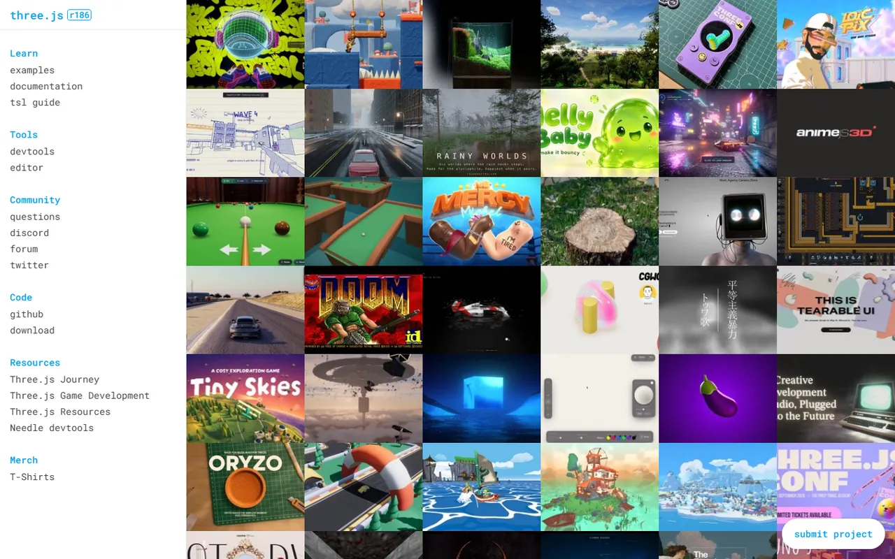</a>

**More references**

<table>
<tr>
<td width="50%" valign="top">
<a href="https://threejs.org/examples/">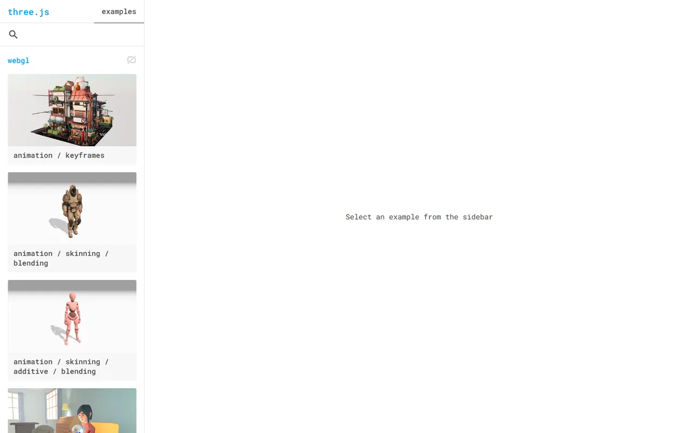</a> <a href="https://threejs.org/examples/">Examples</a>
</td>
</tr>
</table>

---

### [React Three Fiber](https://r3f.docs.pmnd.rs) 🆓⚛️

React renderer for Three.js.

<a href="https://r3f.docs.pmnd.rs">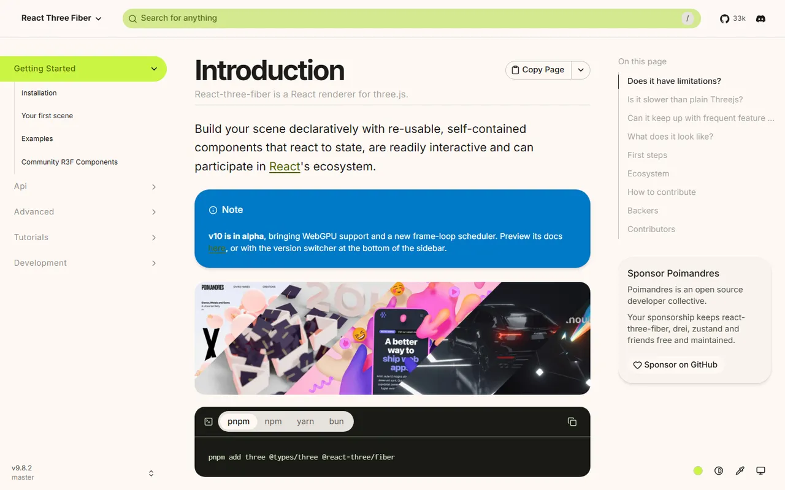</a>

---

### [Drei](https://drei.docs.pmnd.rs) 🆓⚛️

Helpers and abstractions for R3F.

<a href="https://drei.docs.pmnd.rs">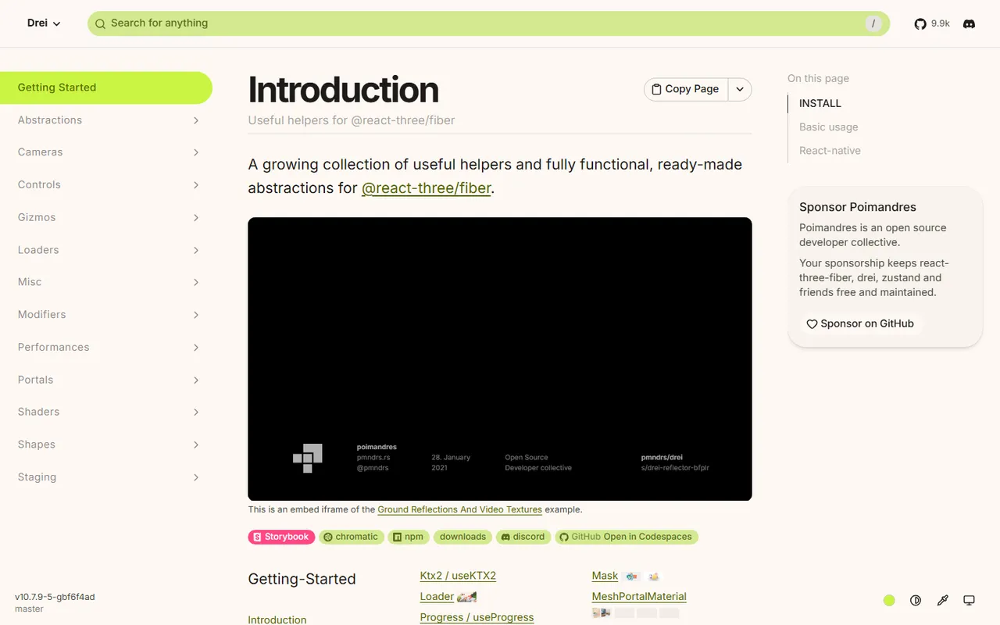</a>

---

### [TresJS](https://tresjs.org) 🆓🟢

Declarative Three.js for Vue.

<a href="https://tresjs.org">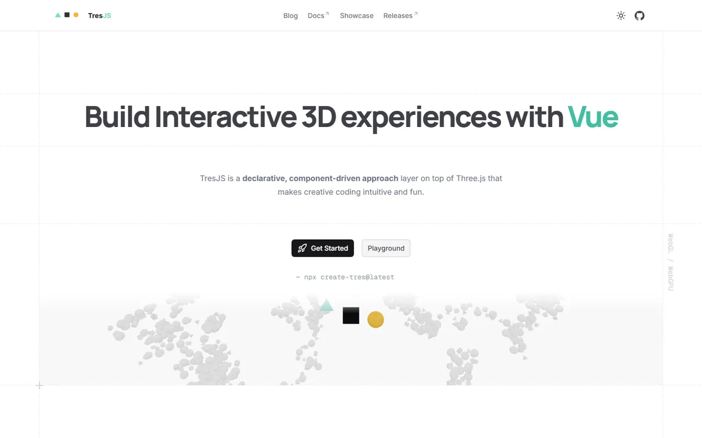</a>

---

### [Threlte](https://threlte.xyz) 🆓🧡

Three.js for Svelte.

<a href="https://threlte.xyz">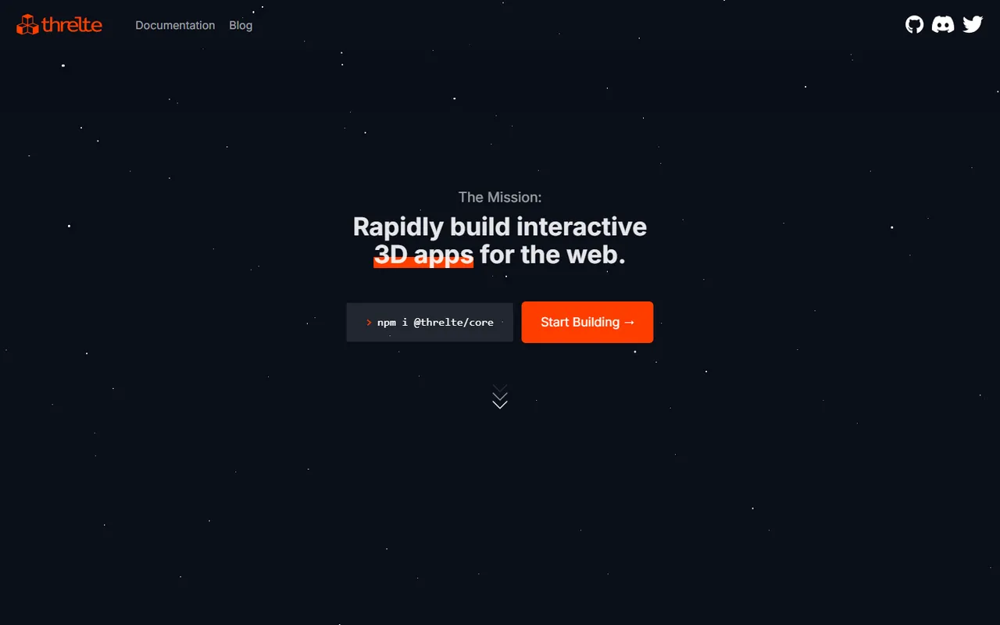</a>

---

### [Babylon.js](https://www.babylonjs.com) 🆓🌐

Full-featured 3D engine.

<a href="https://www.babylonjs.com">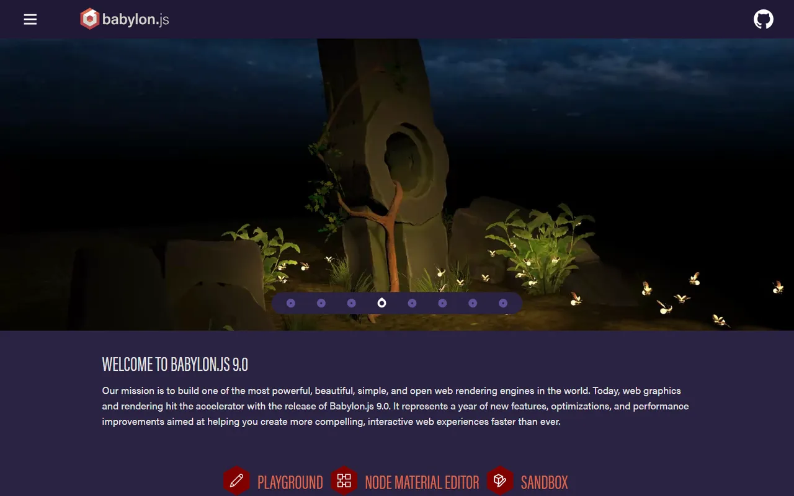</a>

---

### [PlayCanvas](https://playcanvas.com) 🆓💎🌐

WebGL/WebGPU engine and editor.

<a href="https://playcanvas.com">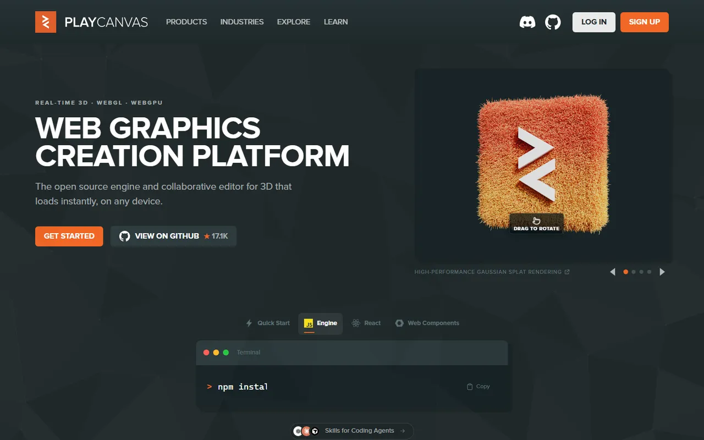</a>

---

### [OGL](https://github.com/oframe/ogl) 🆓🌐

Minimal WebGL library.

<a href="https://github.com/oframe/ogl">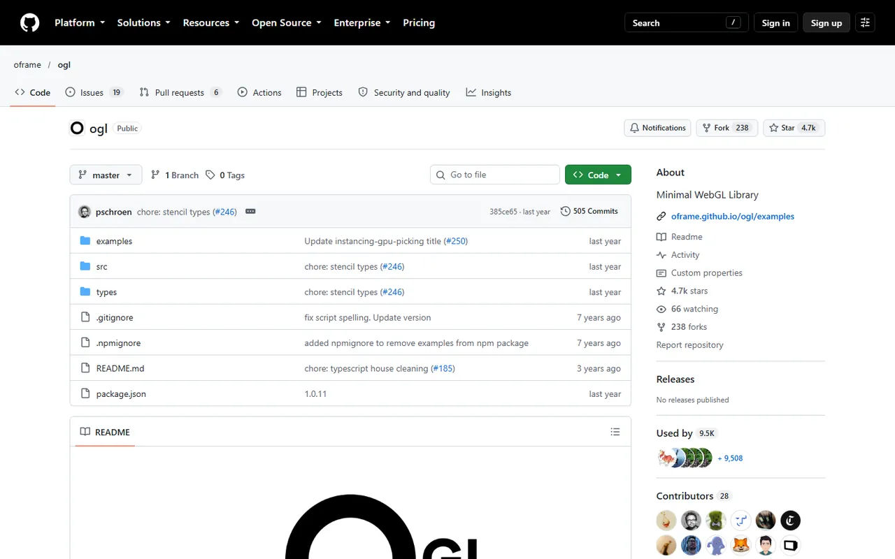</a>

---

### [PixiJS](https://pixijs.com) 🆓🌐

Fast 2D renderer for interactive graphics.

<a href="https://pixijs.com">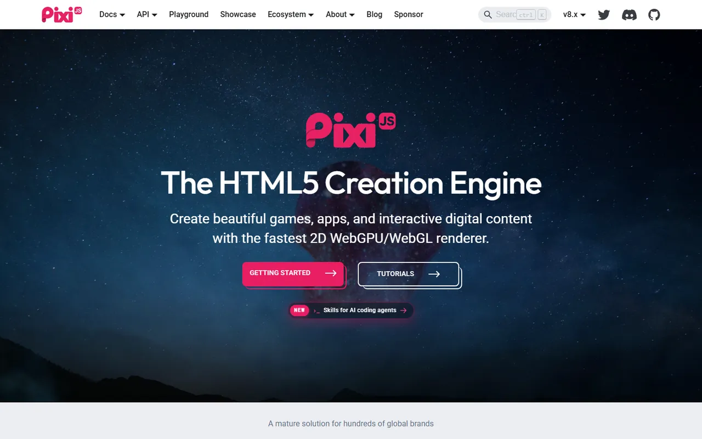</a>

---

### [p5.js](https://p5js.org) 🆓🌐

Creative coding for artists and designers.

<a href="https://p5js.org">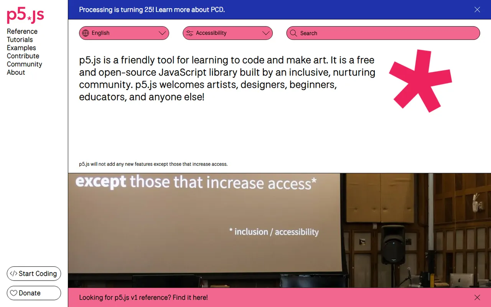</a>

---

### [Matter.js](https://brm.io/matter-js/) 🆓🌐

2D physics engine.

<a href="https://brm.io/matter-js/">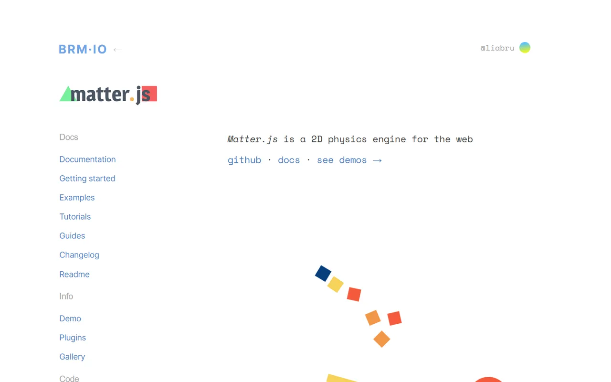</a>

---

### [Rough.js](https://roughjs.com) 🆓🌐

Hand-drawn, sketchy graphics.

<a href="https://roughjs.com">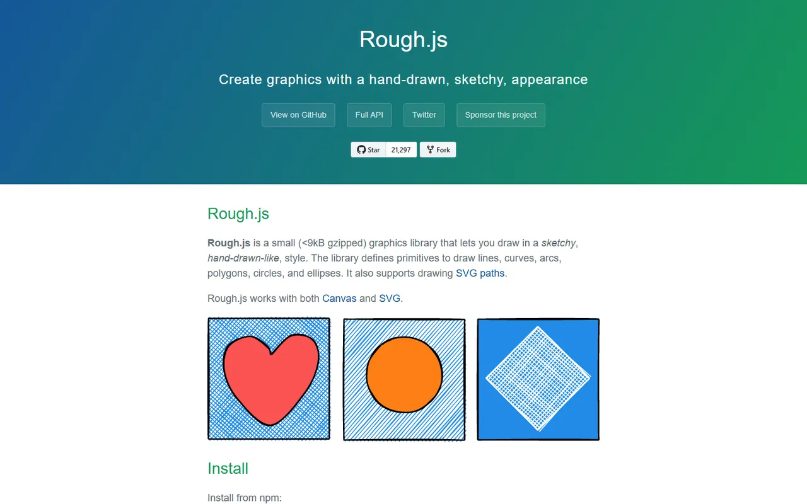</a>

---
