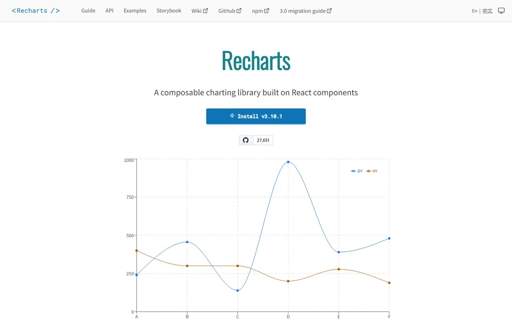
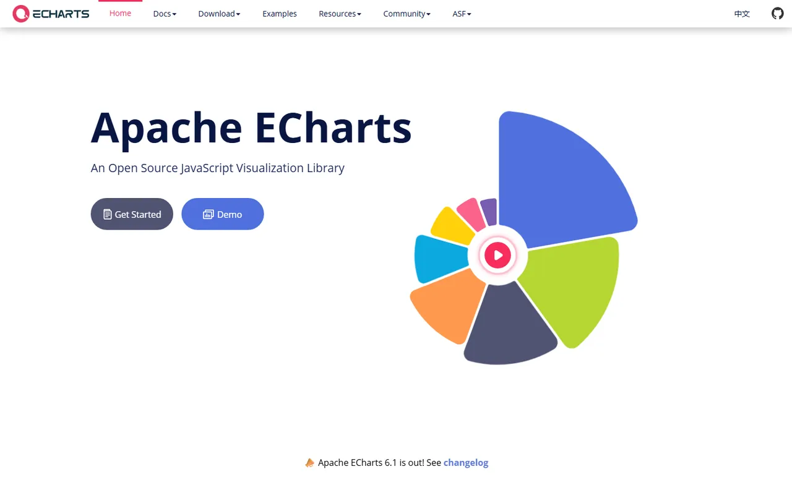
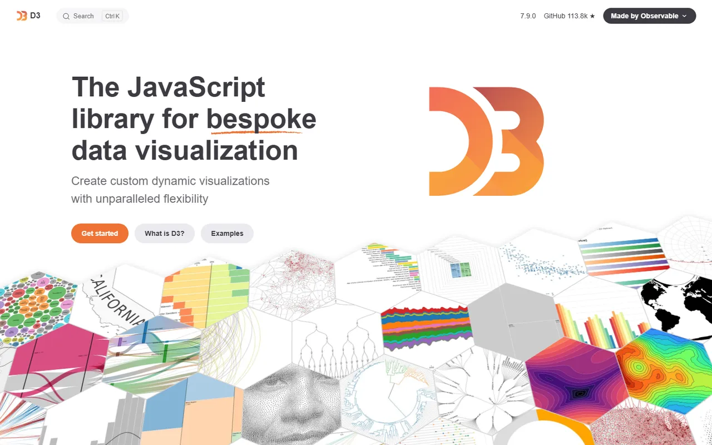
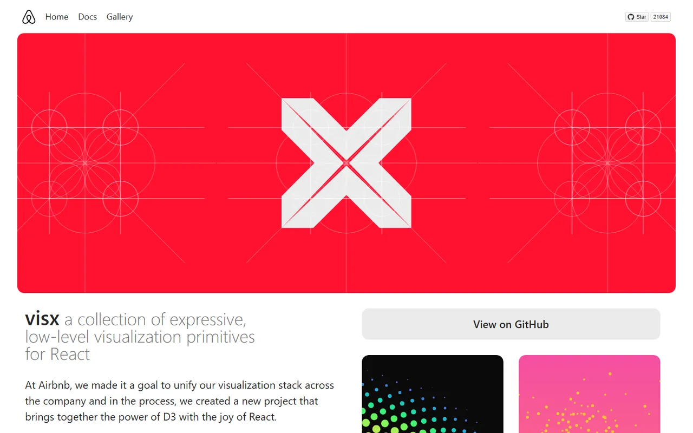
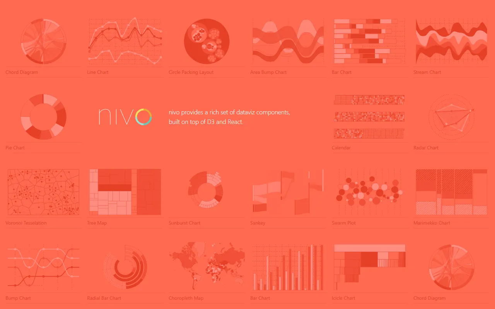
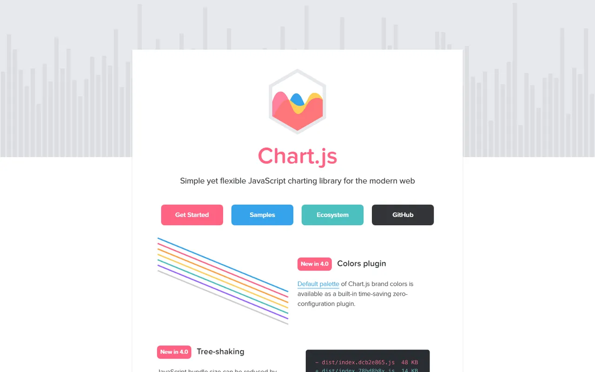
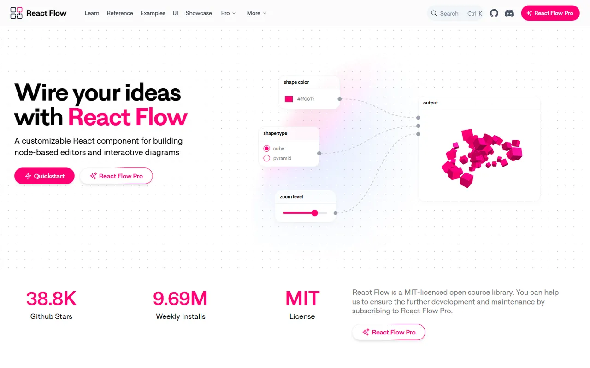

# Charts & Data Visualization - Gallery

[← Back to list](../README.md#charts--data-visualization) · [All galleries](README.md)

### [Recharts](https://recharts.org) 🆓⚛️

Composable React charts (powers shadcn charts).

---

### [Apache ECharts](https://echarts.apache.org) 🆓🌐

Powerful, interactive charting.

---

### [D3](https://d3js.org) 🆓🌐

Low-level data visualization toolkit.

---

### [Observable Plot](https://observablehq.com/plot/) 🆓🌐

Concise exploratory charts.

---

### [visx](https://airbnb.io/visx) 🆓⚛️

Low-level React visualization primitives.

---

### [Nivo](https://nivo.rocks) 🆓⚛️

Rich React chart components.

---

### [Chart.js](https://www.chartjs.org) 🆓🌐

Simple canvas charts.

---

### [React Flow](https://reactflow.dev) 🆓💎⚛️🧡

Node-based UIs, diagrams and editors.

---
