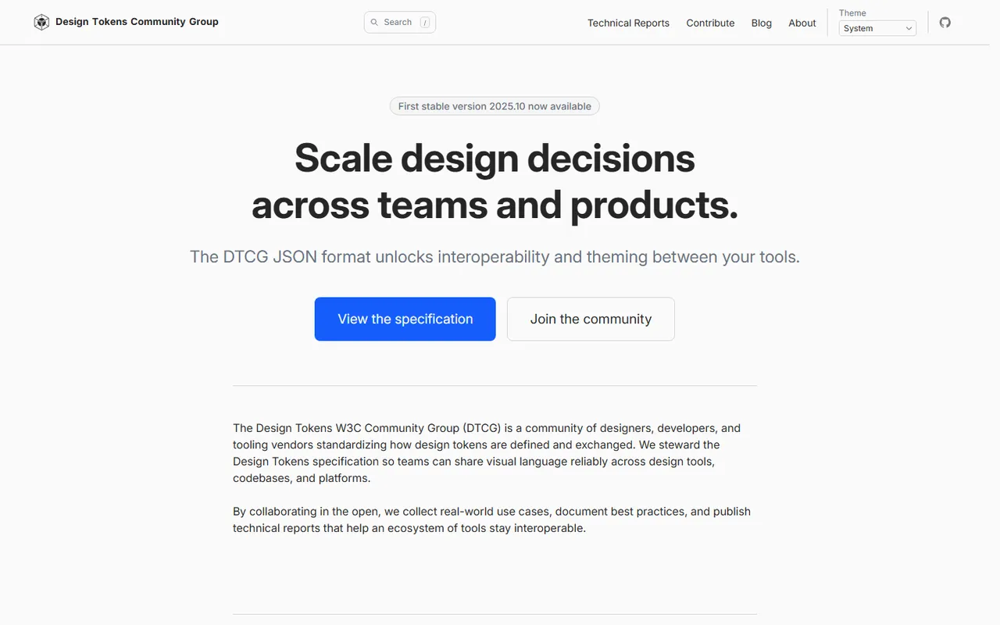
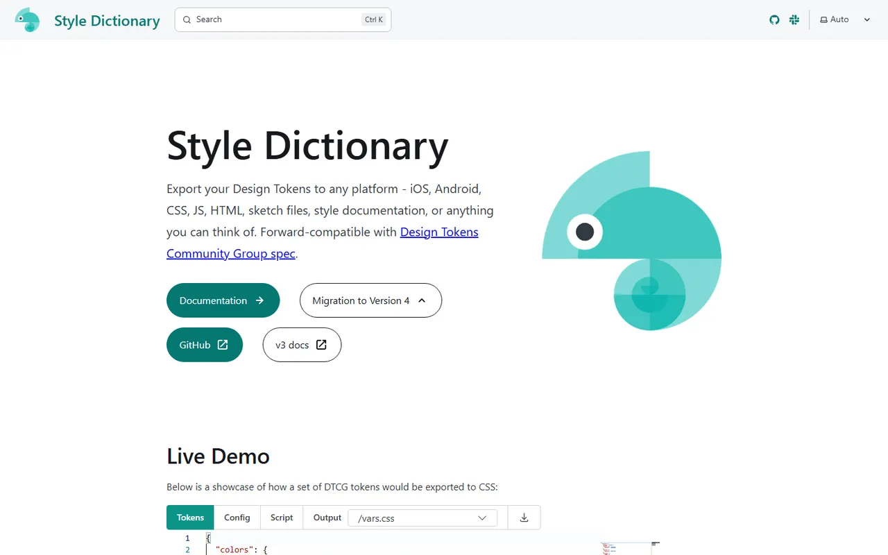
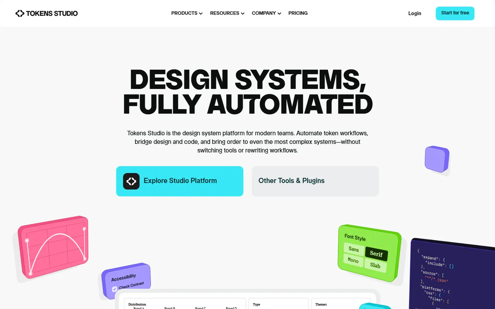
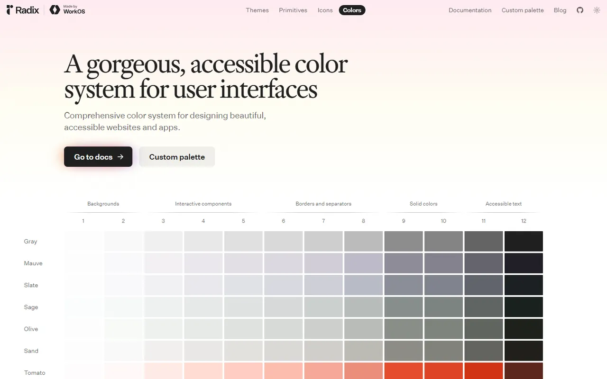
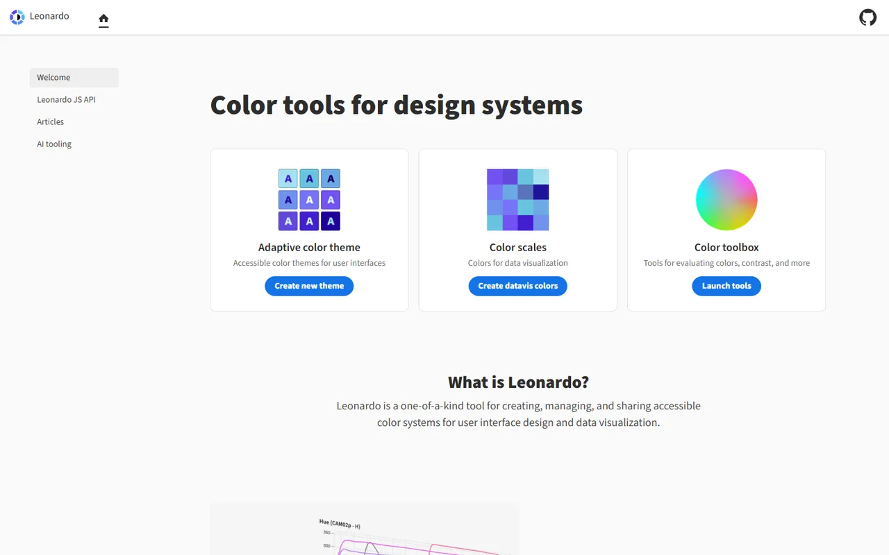
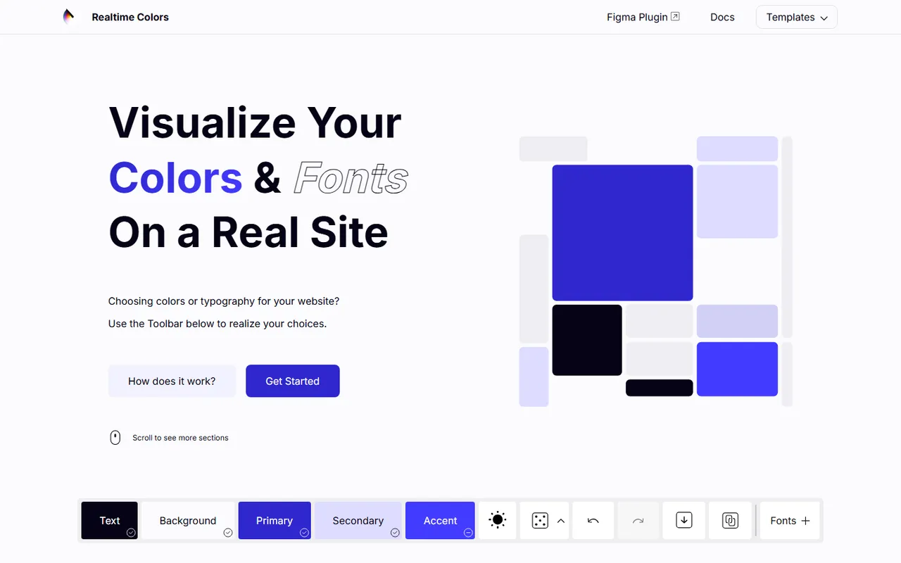
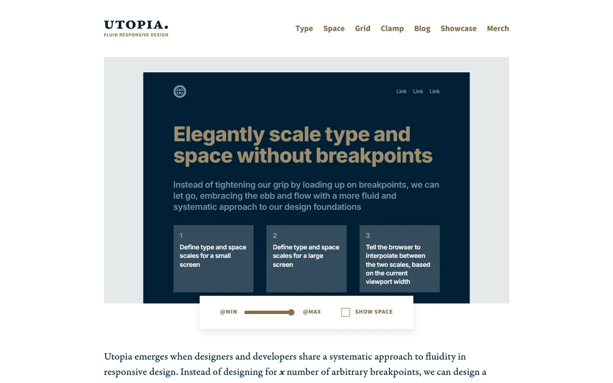

# Color, Tokens & Theming - Gallery

[← Back to list](../README.md#color-tokens--theming) · [All galleries](README.md)

### [Design Tokens Community Group](https://www.designtokens.org) 🆓

W3C spec for interoperable tokens.

---

### [Style Dictionary](https://styledictionary.com) 🆓

Transform tokens into any platform's format.

---

### [Tokens Studio](https://tokens.studio) 🆓💎

Manage tokens in Figma and sync to code.

---

### [Radix Colors](https://www.radix-ui.com/colors) 🆓

Accessible color scales with dark mode.

---

### [Leonardo](https://leonardocolor.io) 🆓

Adobe's contrast-based color generator.

---

### [Realtime Colors](https://www.realtimecolors.com) 🆓

Preview palettes on a real layout.

---

### [Utopia](https://utopia.fyi) 🆓

Fluid type and space scales.

---
