# Design Systems - Gallery

[← Back to list](../README.md#design-systems) · [All galleries](README.md)

### [Material Design 3](https://m3.material.io) 🆓

Google's design system with dynamic color and expressive motion.

<a href="https://m3.material.io">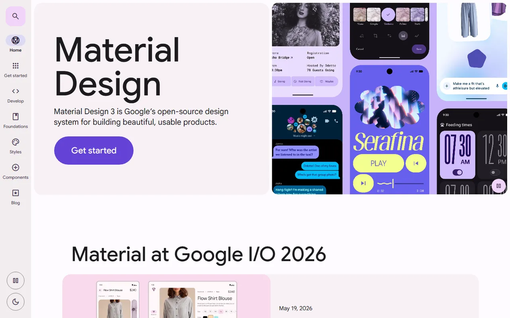</a>

---

### [Apple Human Interface Guidelines](https://developer.apple.com/design/human-interface-guidelines) 🆓

Platform design guidance from Apple.

<a href="https://developer.apple.com/design/human-interface-guidelines">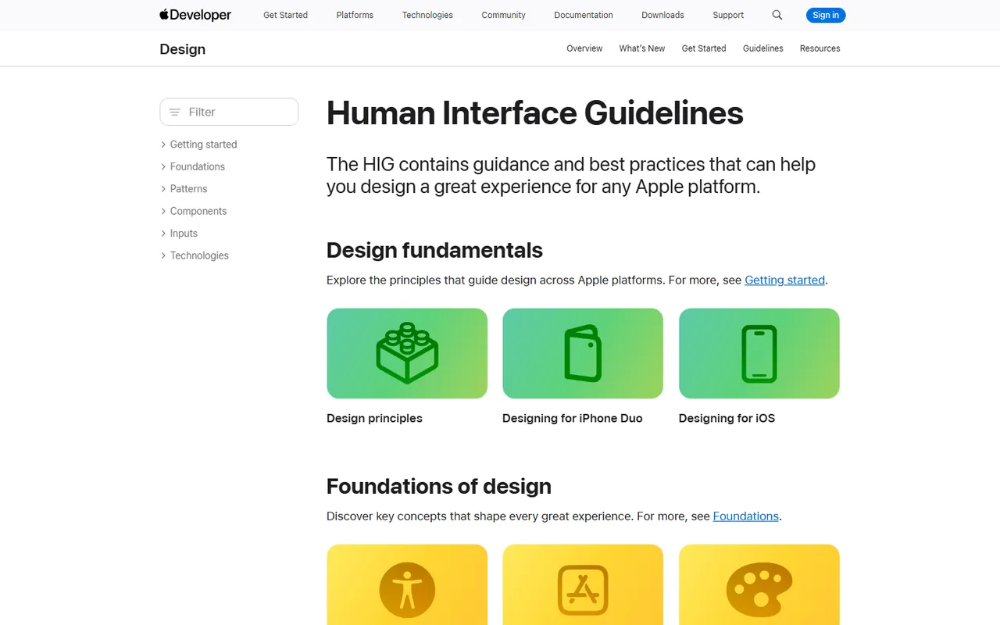</a>

---

### [Fluent 2](https://fluent2.microsoft.design) 🆓

Microsoft's cross-platform design system.

<a href="https://fluent2.microsoft.design">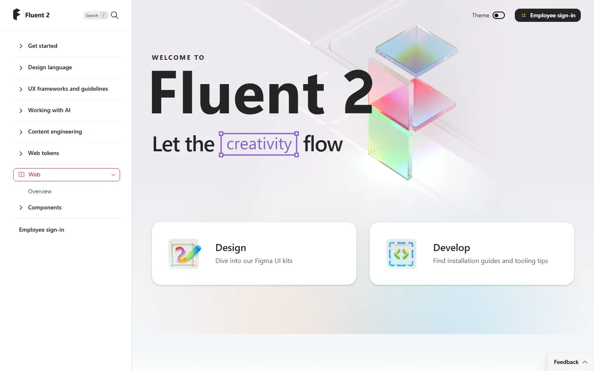</a>

---

### [Carbon](https://carbondesignsystem.com) 🆓

IBM's open-source system for products and digital experiences.

<a href="https://carbondesignsystem.com">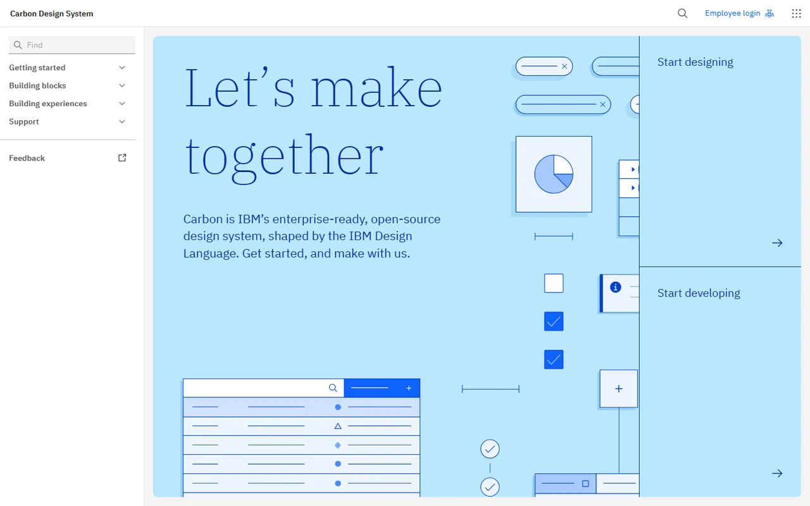</a>

---

### [Atlassian Design System](https://atlassian.design) 🆓

Foundations, tokens and components behind Jira and Confluence.

<a href="https://atlassian.design">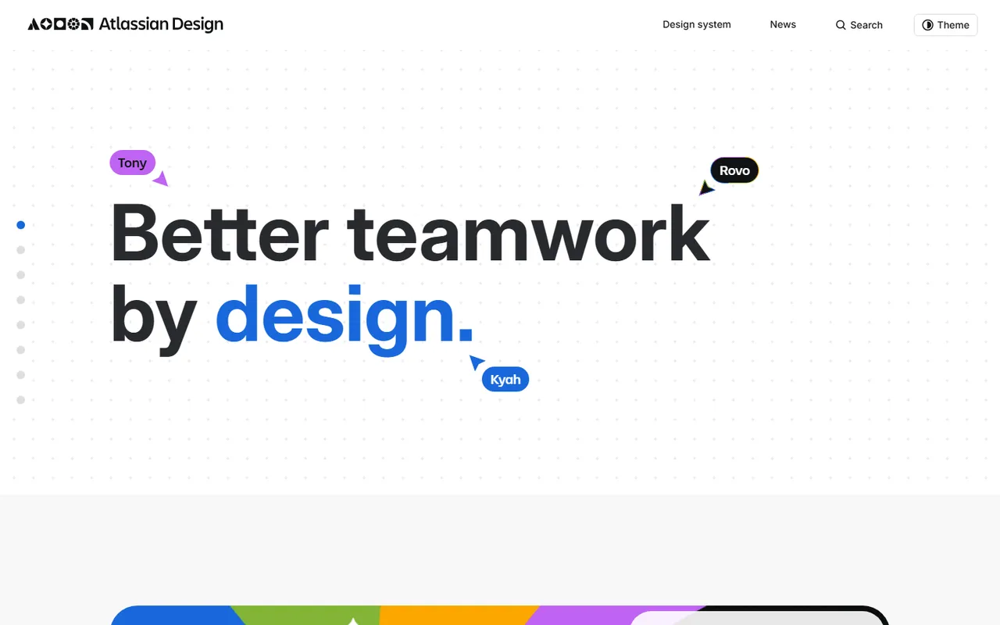</a>

---

### [Primer](https://primer.style) 🆓

GitHub's design system.

<a href="https://primer.style">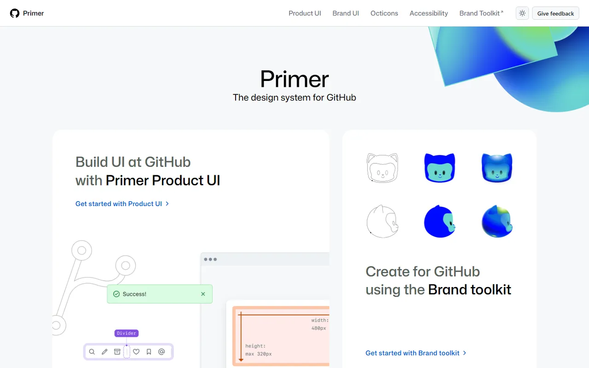</a>

---

### [Ant Design](https://ant.design) 🆓

Enterprise-class design language with a large React implementation.

<a href="https://ant.design">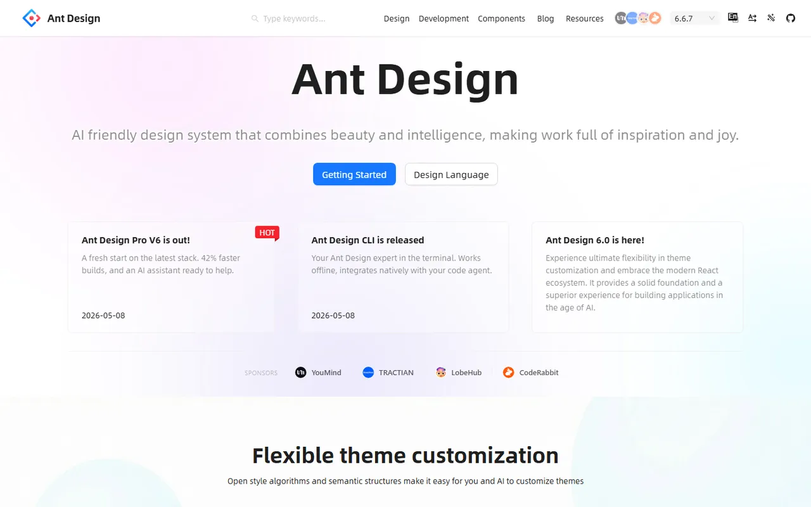</a>

---

### [Spectrum](https://spectrum.adobe.com) 🆓

Adobe's design system (React Spectrum, Spectrum Web Components).

<a href="https://spectrum.adobe.com">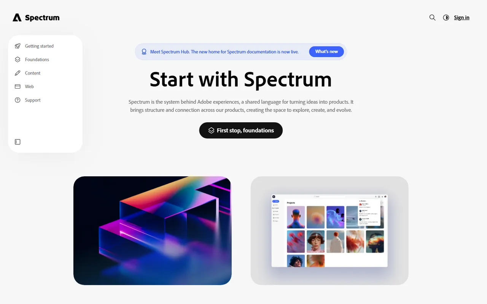</a>

---

### [Geist](https://vercel.com/geist) 🆓

Vercel's minimal design system and typeface.

<a href="https://vercel.com/geist">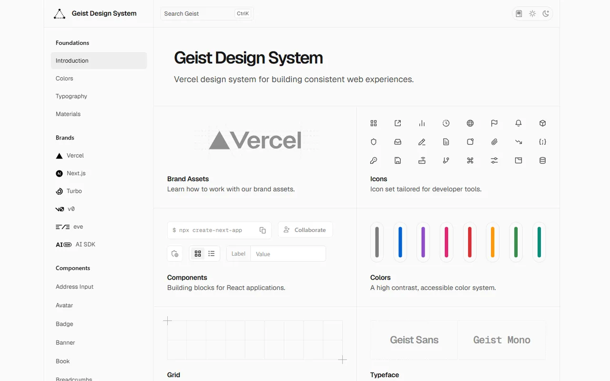</a>

---

### [Gestalt](https://gestalt.pinterest.systems) 🆓

Pinterest's design system.

<a href="https://gestalt.pinterest.systems">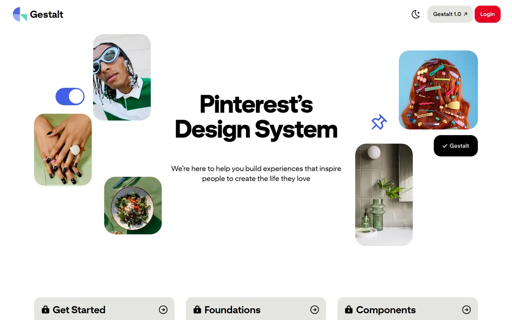</a>

---

### [Base Web](https://baseweb.design) 🆓

Uber's design system.

<a href="https://baseweb.design">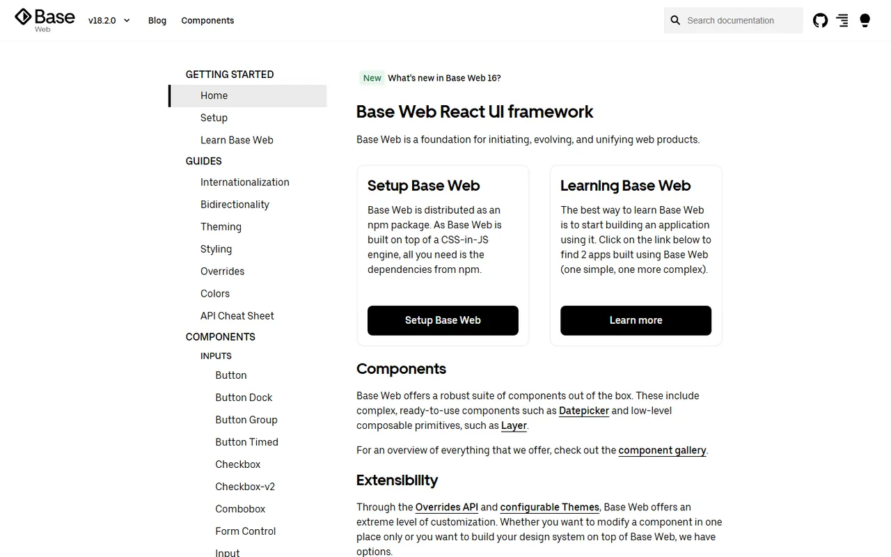</a>

---

### [Elastic UI (EUI)](https://eui.elastic.co) 🆓

Elastic's design system for data-rich apps.

<a href="https://eui.elastic.co">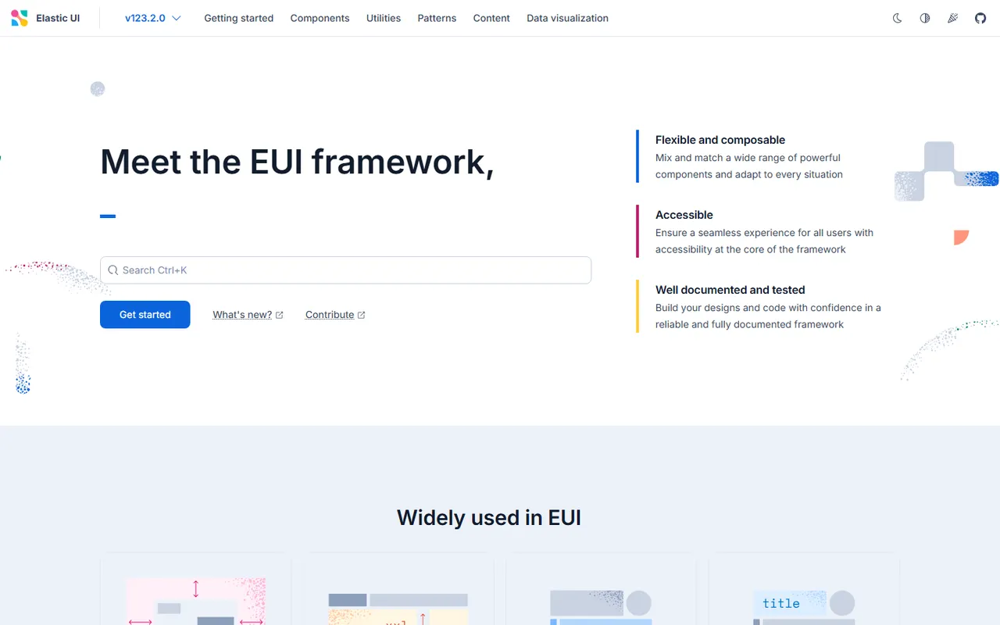</a>

---

### [Salesforce Lightning](https://www.lightningdesignsystem.com) 🆓

Enterprise system from Salesforce.

<a href="https://www.lightningdesignsystem.com">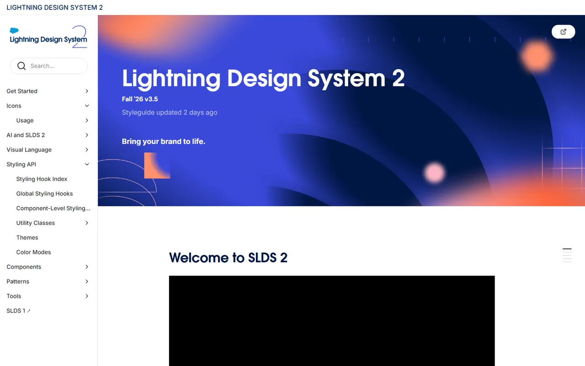</a>

---

### [GOV.UK Design System](https://design-system.service.gov.uk) 🆓

Gold standard for accessible public-service UI.

<a href="https://design-system.service.gov.uk">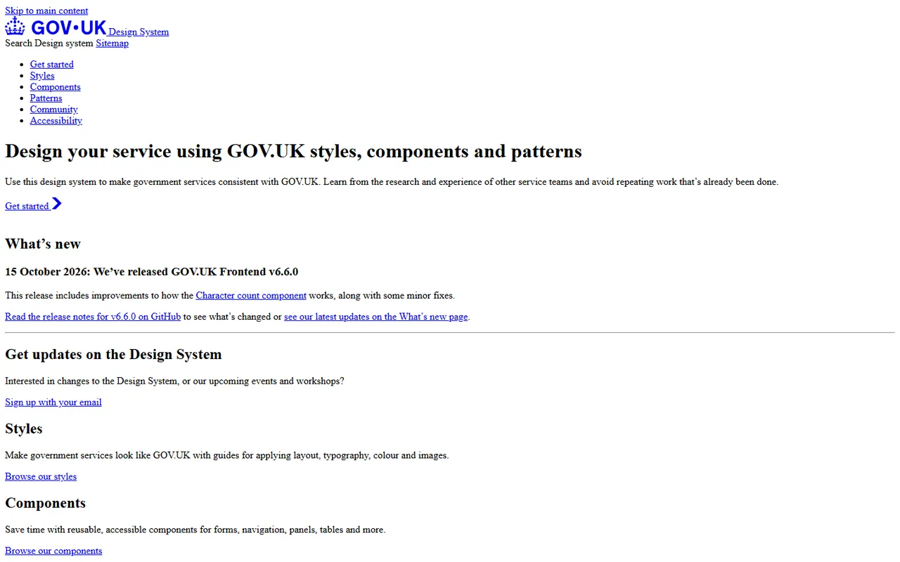</a>

---

### [U.S. Web Design System](https://designsystem.digital.gov) 🆓

Accessible components for U.S. government sites.

<a href="https://designsystem.digital.gov">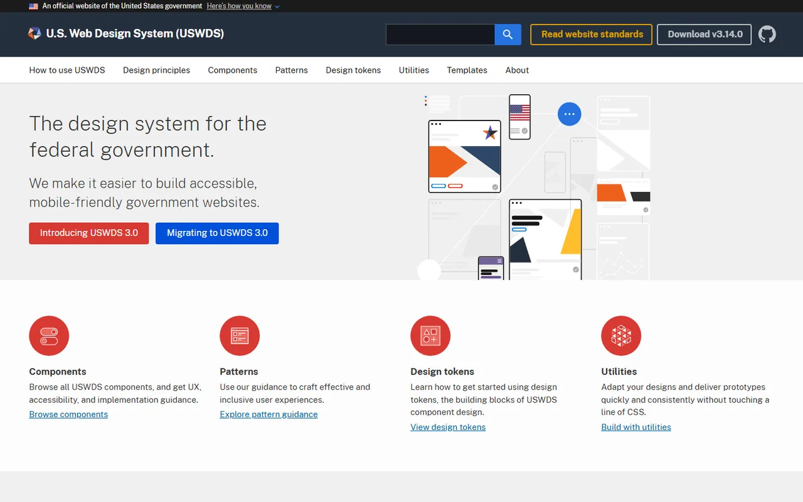</a>

---
