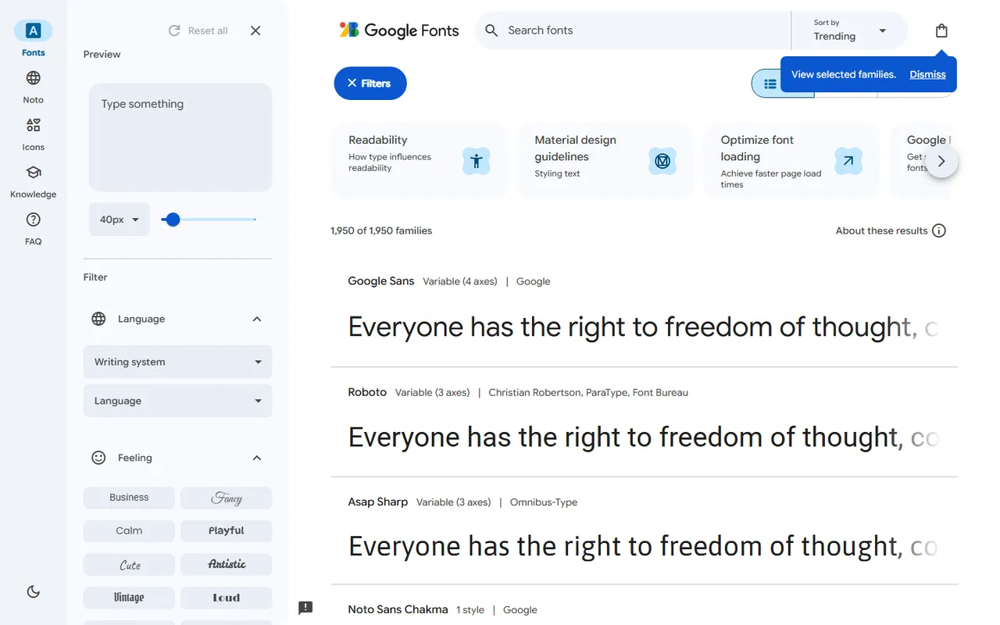
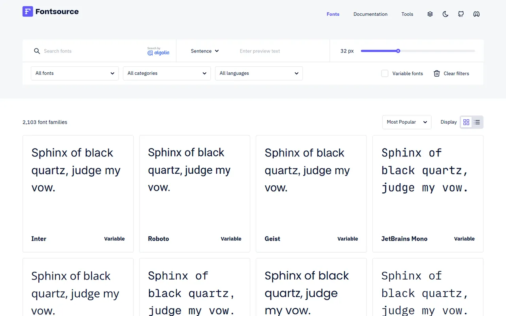
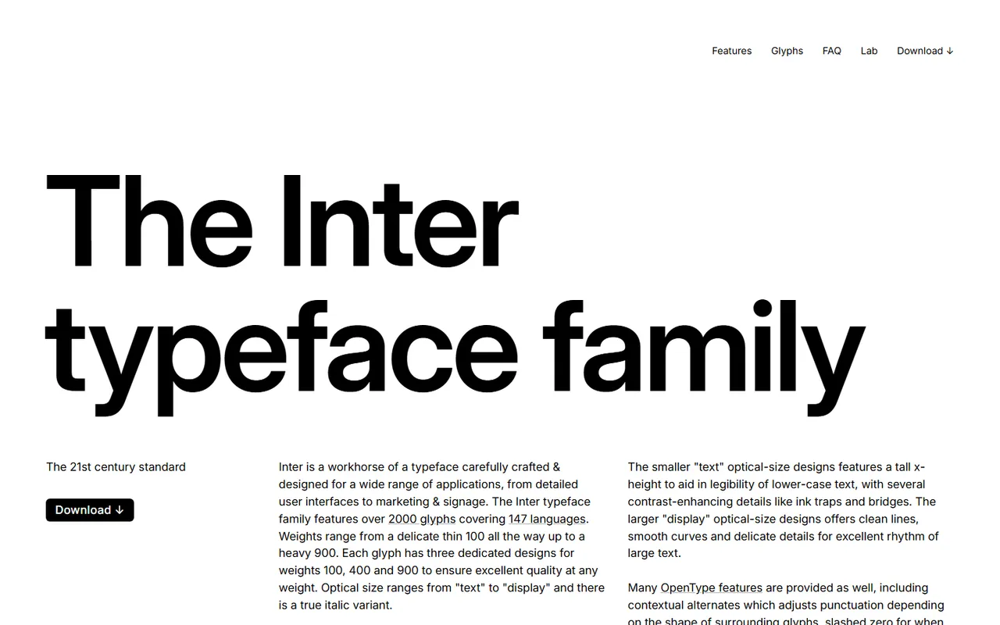
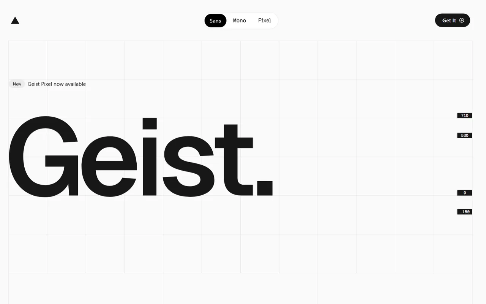

# Fonts - Gallery

[← Back to list](../README.md#fonts) · [All galleries](README.md)

### [Google Fonts](https://fonts.google.com) 🆓

Free web fonts.

---

### [Fontsource](https://fontsource.org) 🆓

Self-host open-source fonts via npm.

---

### [Inter](https://rsms.me/inter/) 🆓

Typeface designed for screens.

---

### [Geist](https://vercel.com/font) 🆓

Vercel's sans and mono typeface.

---
