# Headless Primitives - Gallery

[← Back to list](../README.md#headless-primitives) · [All galleries](README.md)

### [Radix Primitives](https://www.radix-ui.com/primitives) 🆓⚛️

Accessible unstyled React primitives; the original foundation of shadcn/ui.

<a href="https://www.radix-ui.com/primitives">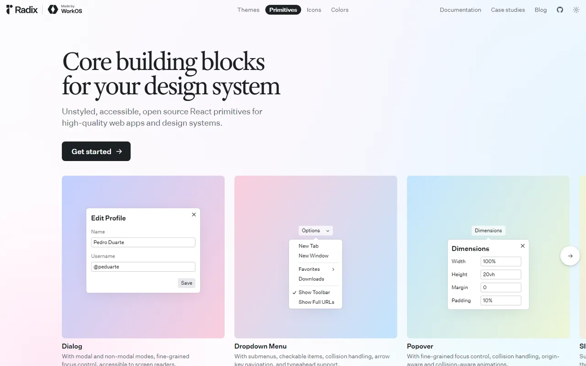</a>

---

### [Base UI](https://base-ui.com) 🆓⚛️

Unstyled components from the creators of Radix, Floating UI and MUI.

<a href="https://base-ui.com">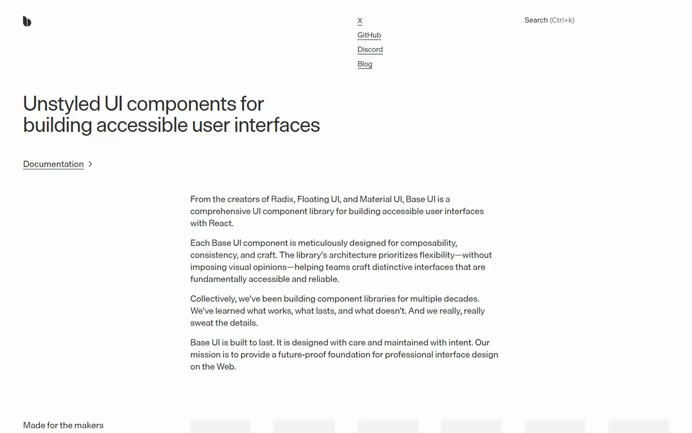</a>

---

### [React Aria](https://react-spectrum.adobe.com/react-aria/) 🆓⚛️

Adobe's hooks and components with best-in-class accessibility and i18n.

<a href="https://react-spectrum.adobe.com/react-aria/">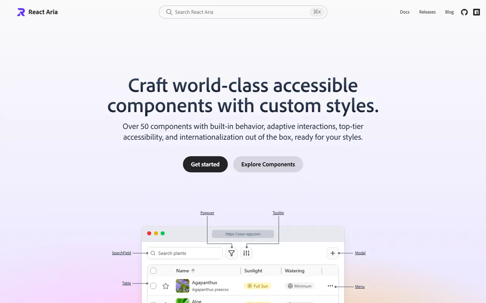</a>

---

### [Headless UI](https://headlessui.com) 🆓⚛️🟢

Unstyled components from the Tailwind team (React & Vue).

<a href="https://headlessui.com">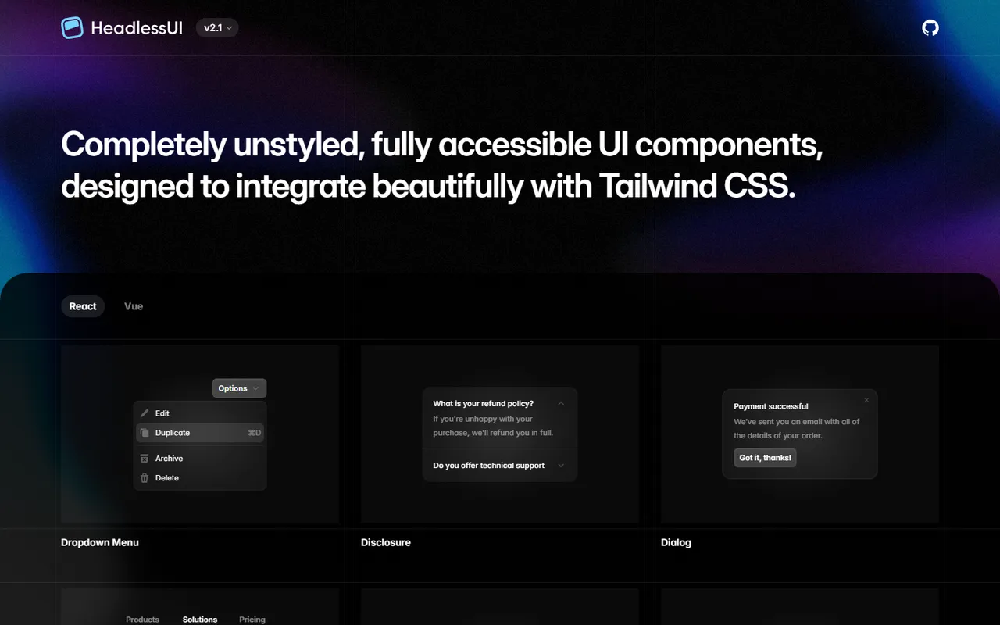</a>

---

### [Ark UI](https://ark-ui.com) 🆓🌐

Headless components for React, Vue, Solid and Svelte, powered by Zag.

<a href="https://ark-ui.com">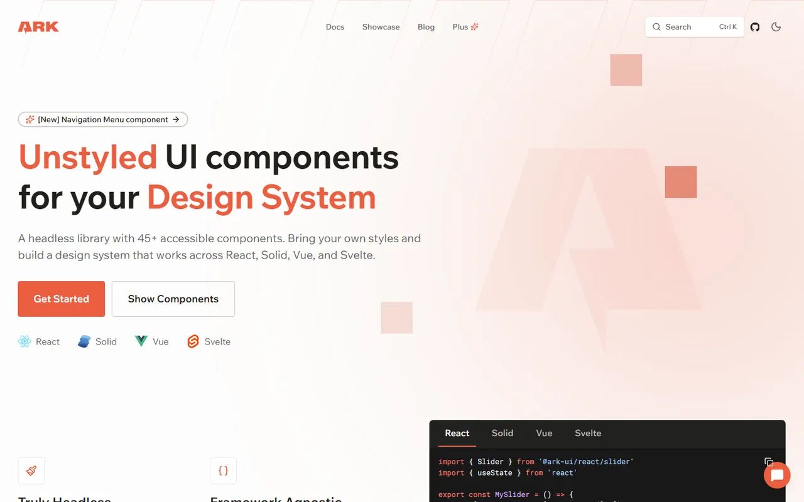</a>

---

### [Zag](https://zagjs.com) 🆓🌐

Framework-agnostic UI component state machines.

<a href="https://zagjs.com">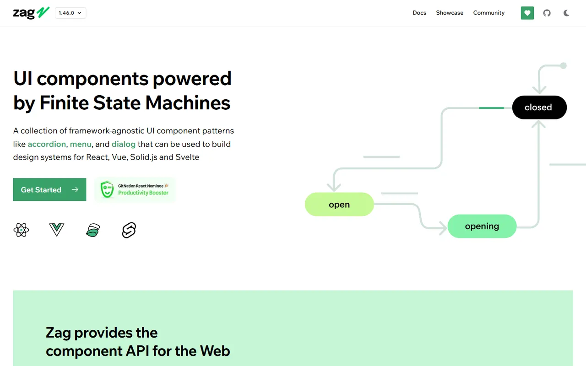</a>

---

### [Ariakit](https://ariakit.org) 🆓⚛️

Lightweight, accessible React primitives.

<a href="https://ariakit.org">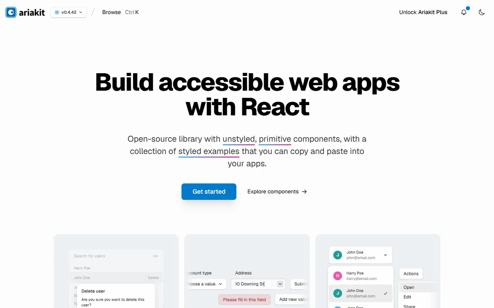</a>

---

### [Reka UI](https://reka-ui.com) 🆓🟢

Vue port of the Radix model (formerly Radix Vue).

<a href="https://reka-ui.com">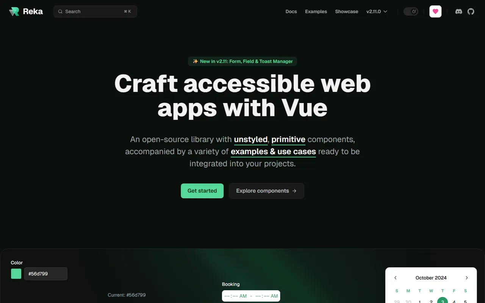</a>

---

### [Bits UI](https://bits-ui.com) 🆓🧡

Headless components for Svelte.

<a href="https://bits-ui.com">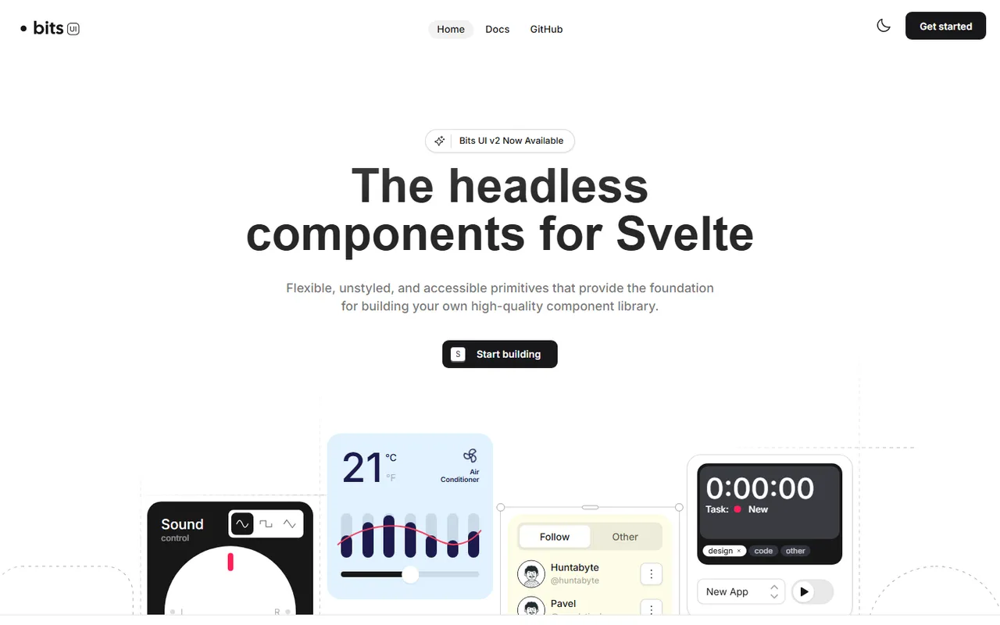</a>

---

### [Melt UI](https://melt-ui.com) 🆓🧡

Headless builders for Svelte.

<a href="https://melt-ui.com">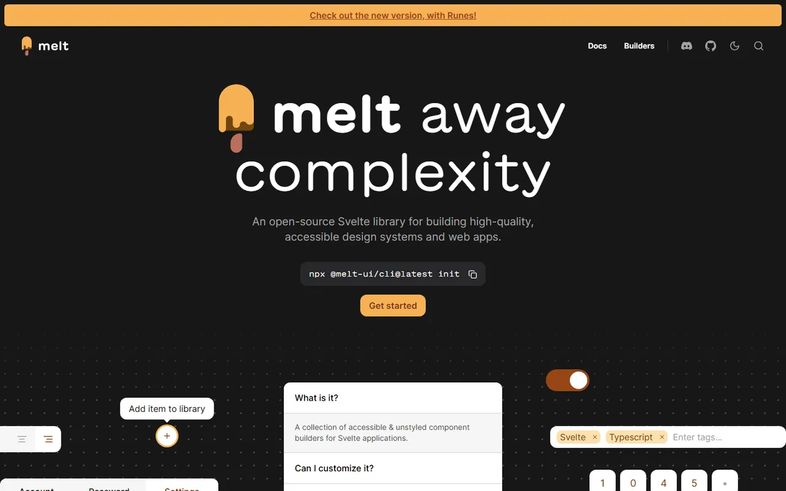</a>

---

### [Kobalte](https://kobalte.dev) 🆓

Accessible headless components for SolidJS.

<a href="https://kobalte.dev">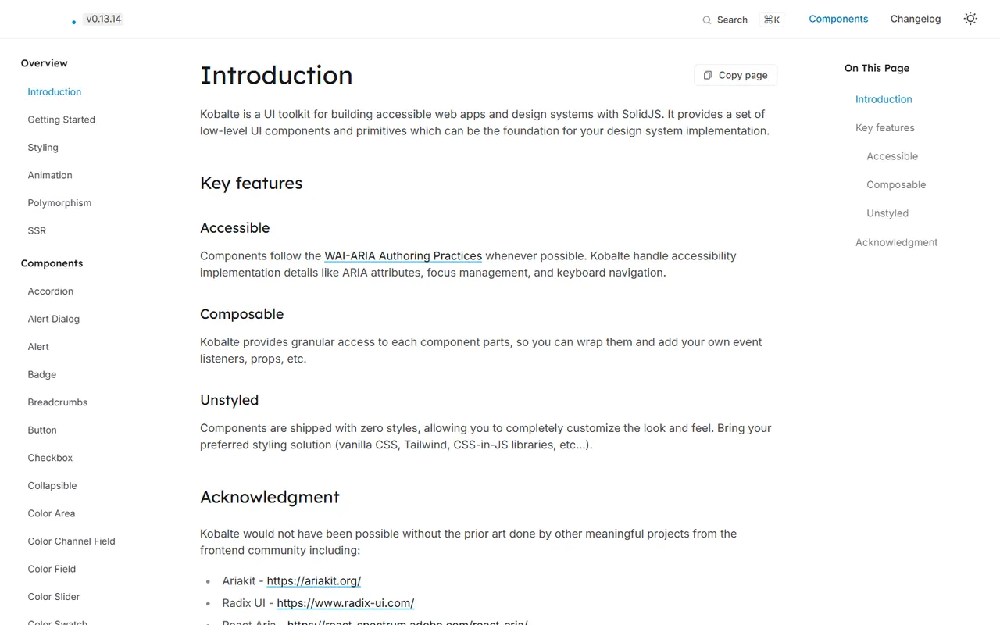</a>

---

### [Floating UI](https://floating-ui.com) 🆓🌐

Positioning engine for tooltips, popovers and dropdowns.

<a href="https://floating-ui.com">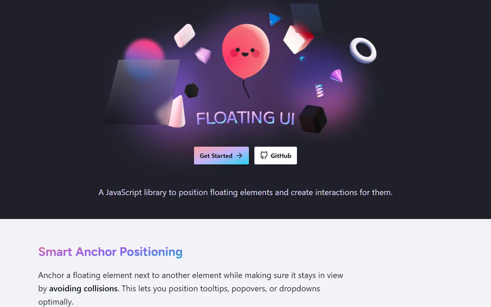</a>

---

### [TanStack Table](https://tanstack.com/table) 🆓🌐

Headless table, virtualization and form logic.

<a href="https://tanstack.com/table">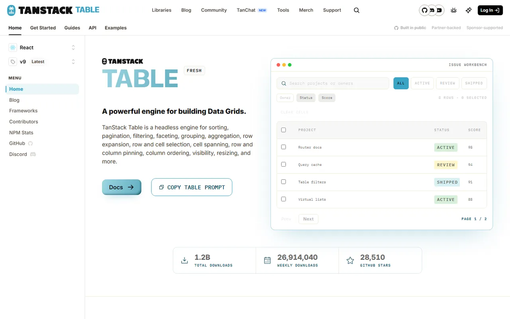</a>

---
