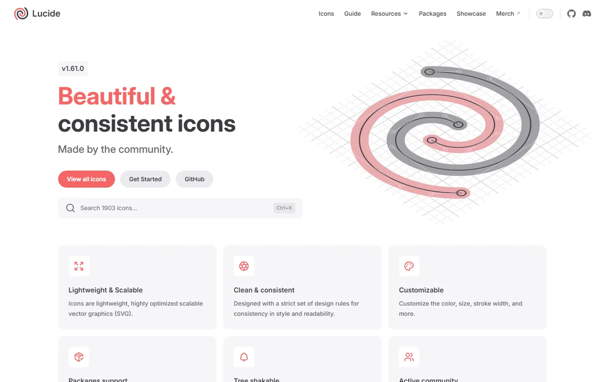
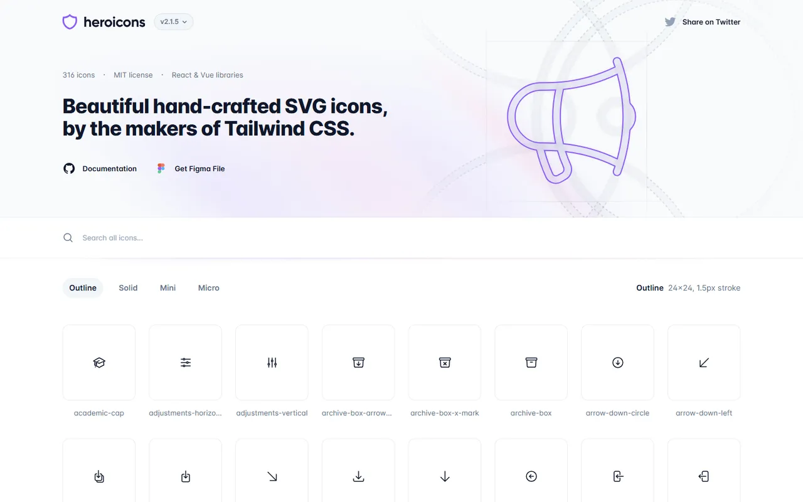
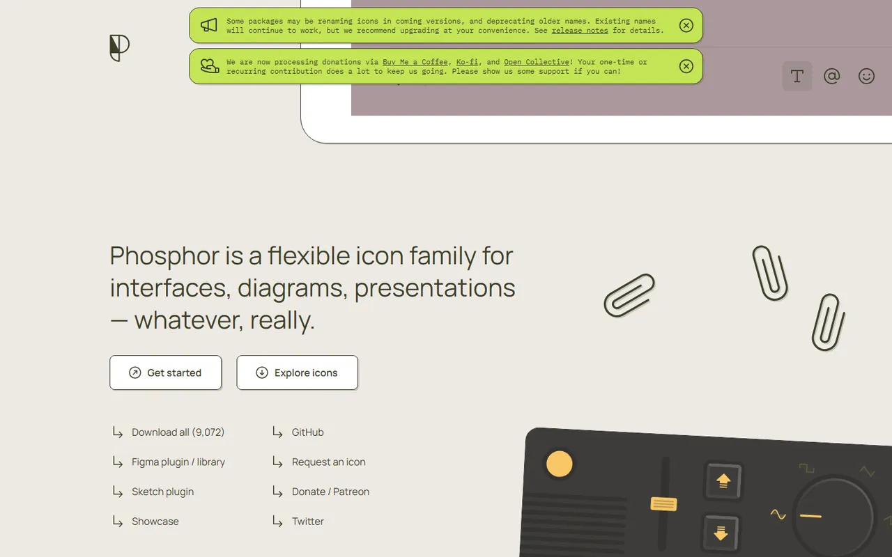
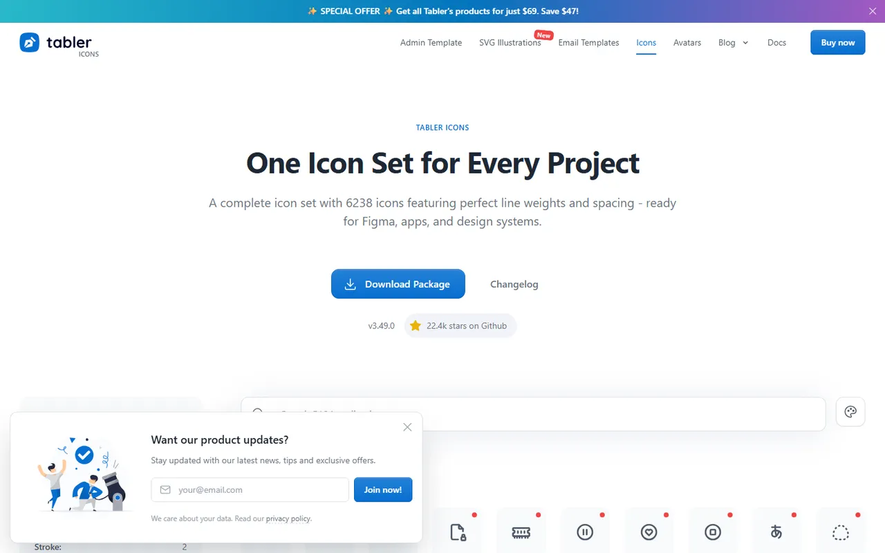
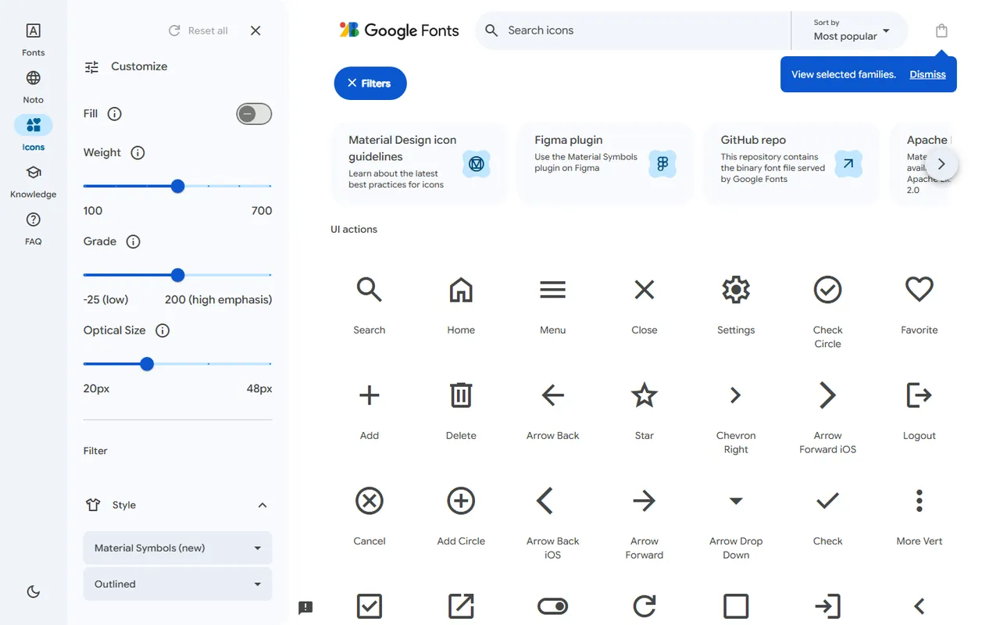
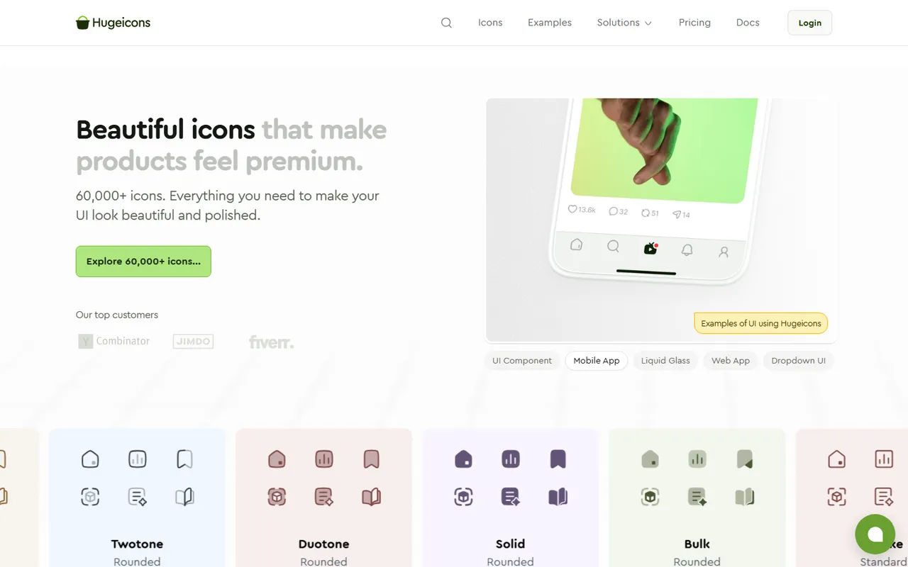
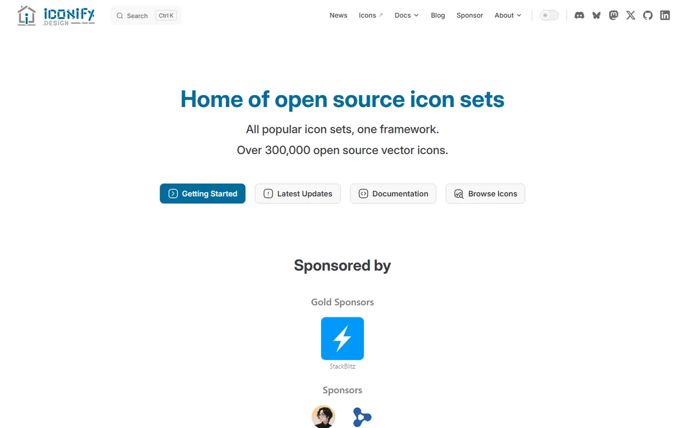

# Icons - Gallery

[← Back to list](../README.md#icons) · [All galleries](README.md)

### [Lucide](https://lucide.dev) 🆓🌐

Clean, consistent open-source icons (shadcn default).

---

### [Heroicons](https://heroicons.com) 🆓🌐

From the Tailwind team.

---

### [Phosphor](https://phosphoricons.com) 🆓🌐

Flexible family with six weights.

---

### [Tabler Icons](https://tabler.io/icons) 🆓🌐

5000+ stroke icons.

---

### [Material Symbols](https://fonts.google.com/icons) 🆓🌐

Google's variable icon font.

---

### [Hugeicons](https://hugeicons.com) 🆓💎🌐

Large icon set with free tier.

---

### [Iconify](https://iconify.design) 🆓🌐

One API for 200k+ icons from many sets.

---
