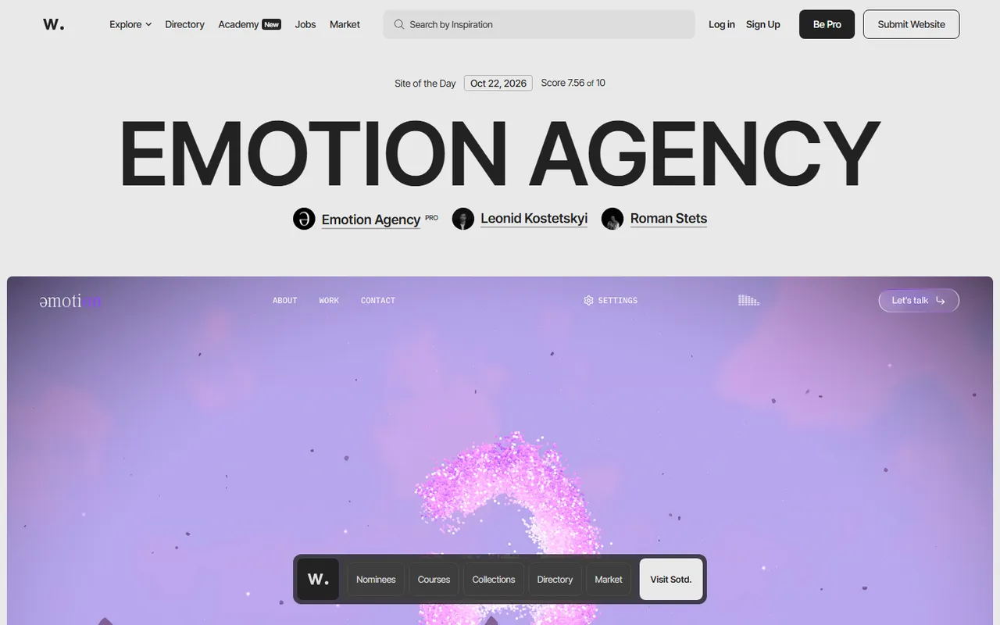
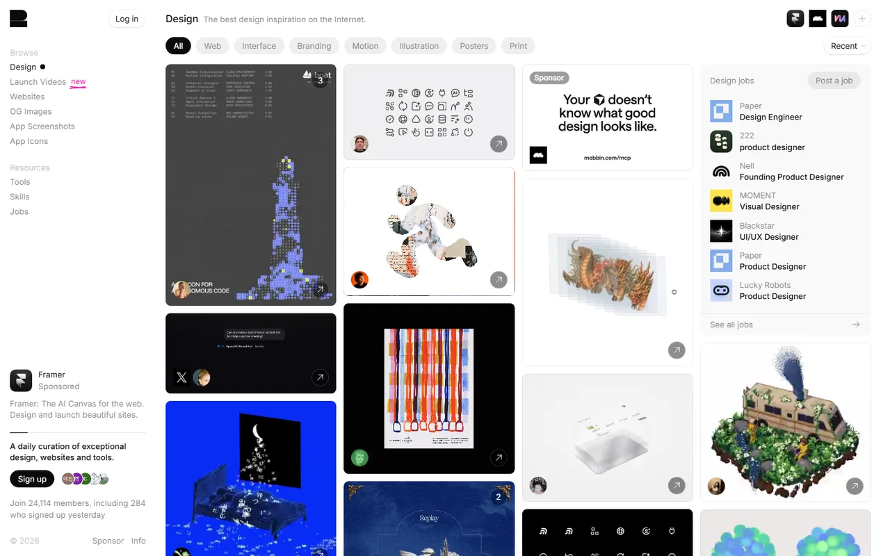
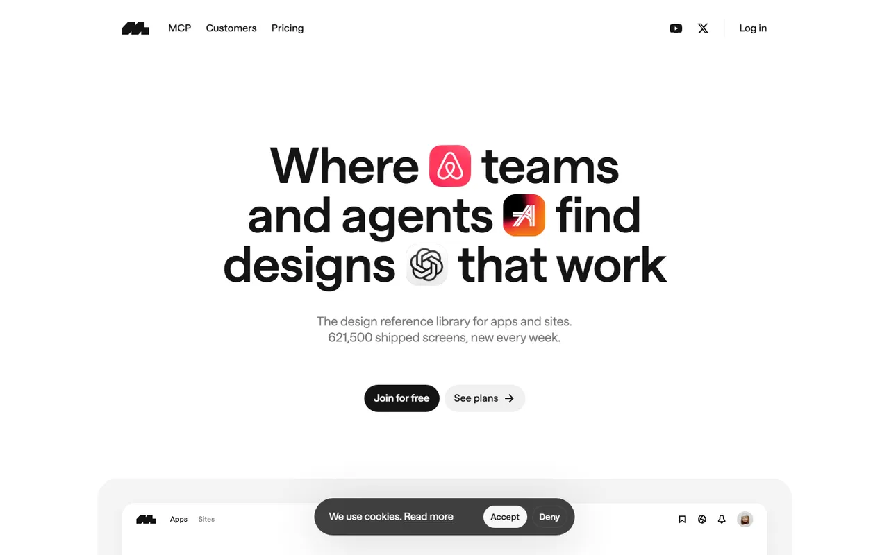
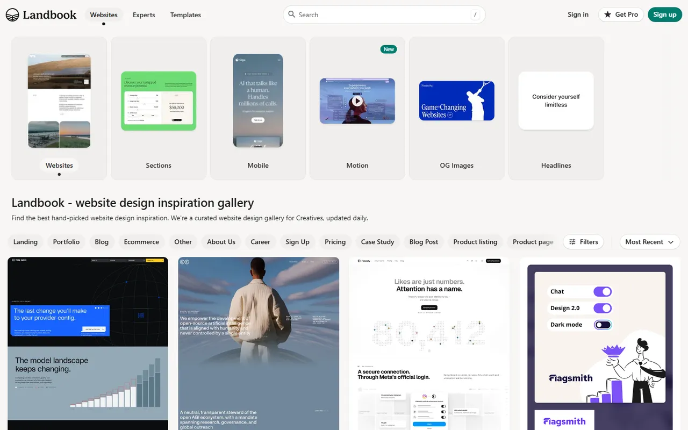
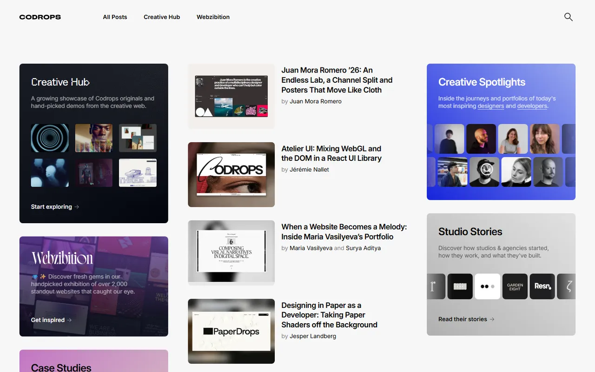
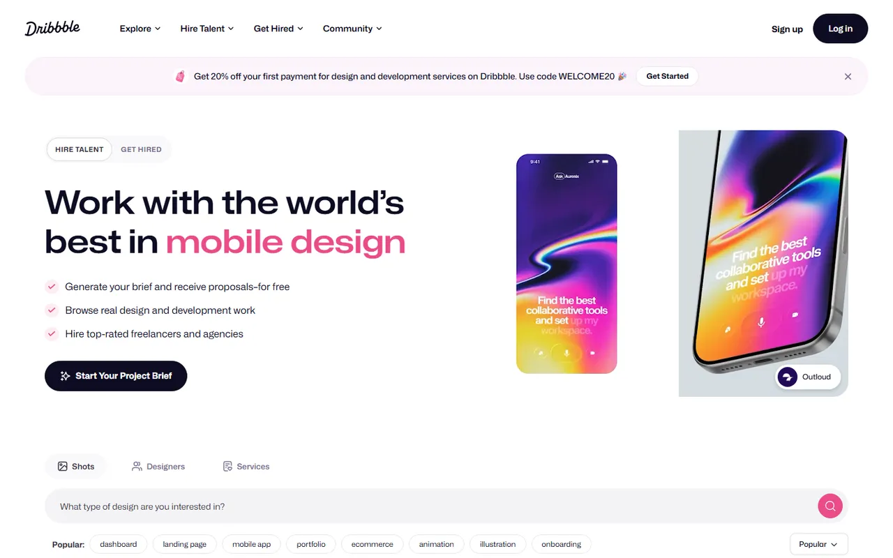

# Inspiration & Galleries - Gallery

[← Back to list](../README.md#inspiration--galleries) · [All galleries](README.md)

### [Awwwards](https://www.awwwards.com)

Award-winning web design.

---

### [Godly](https://godly.website)

Astronomically good web design inspiration.

---

### [Mobbin](https://mobbin.com) 💎

Real-world app UI patterns.

---

### [Land-book](https://land-book.com)

Landing page gallery.

---

### [Codrops](https://tympanus.net/codrops/)

Creative frontend tutorials and demos.

---

### [Dribbble](https://dribbble.com)

Designer showcase.

---
