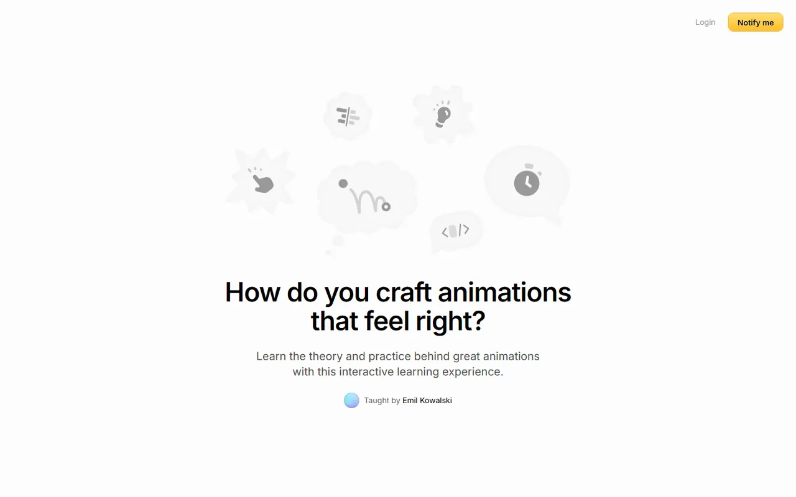
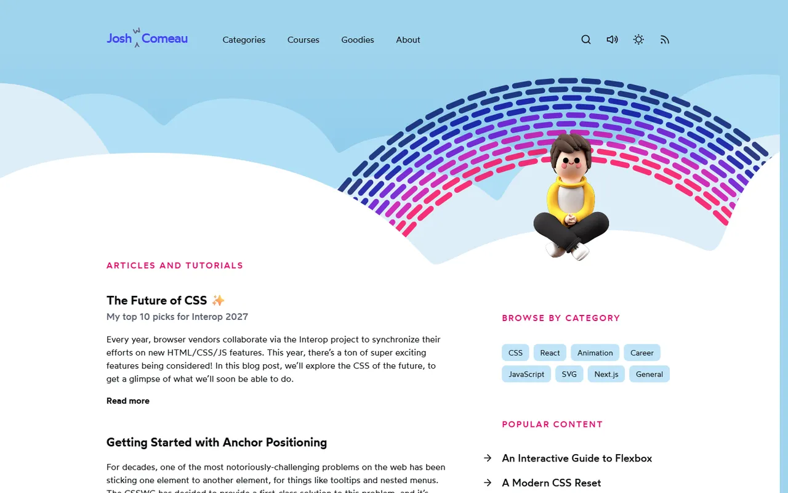
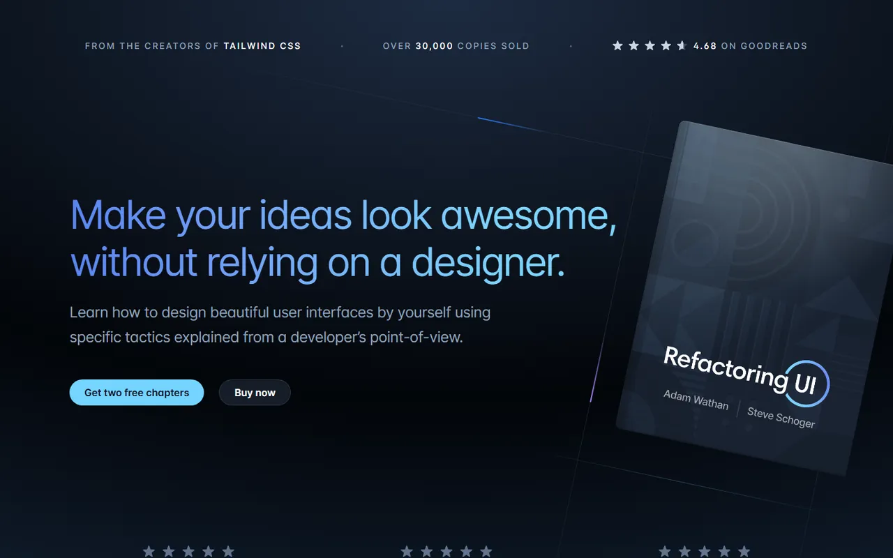
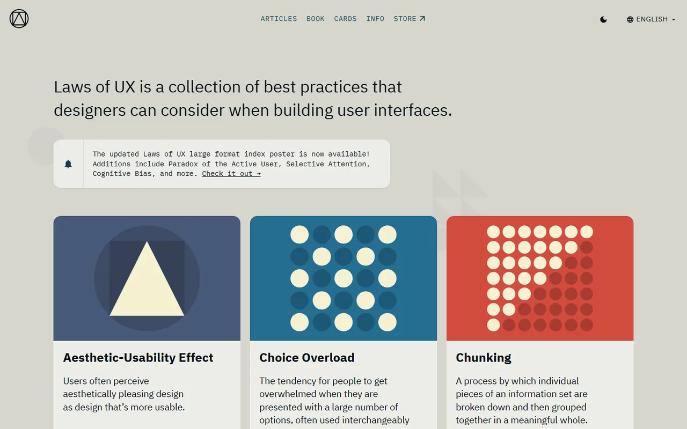
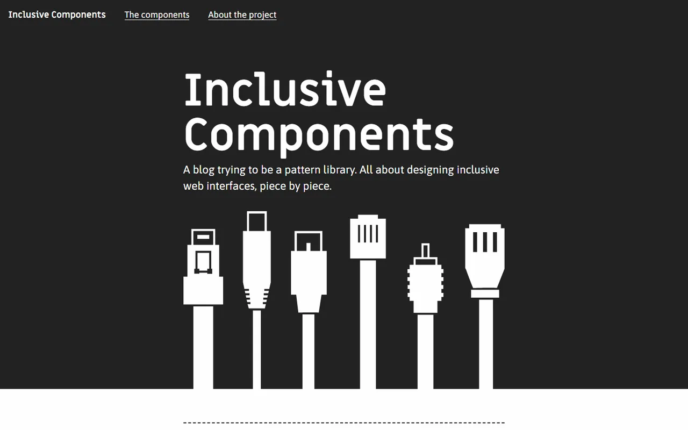
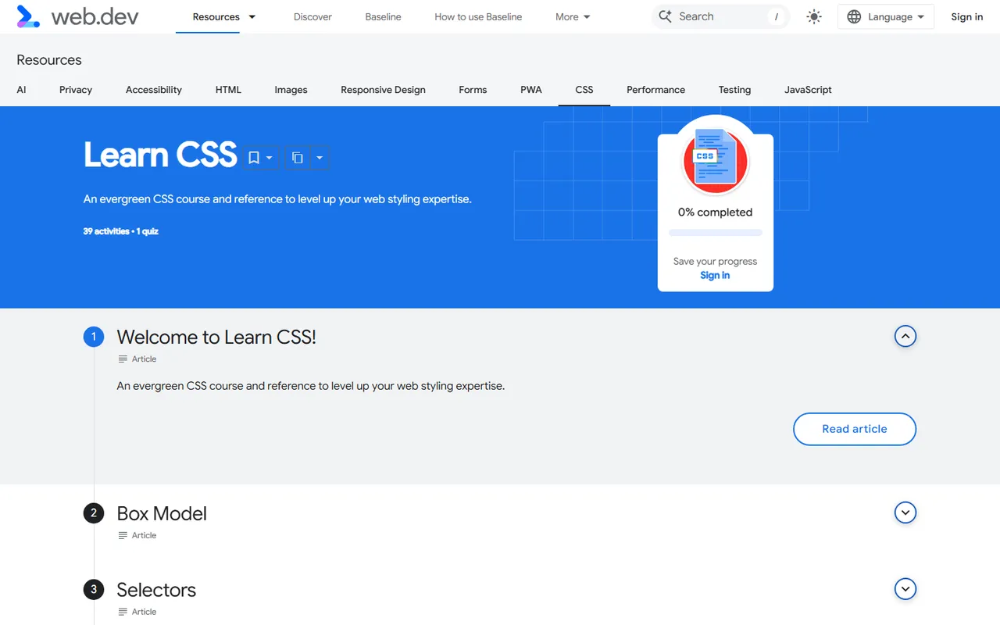

# Learning Resources - Gallery

[← Back to list](../README.md#learning-resources) · [All galleries](README.md)

### [animations.dev](https://animations.dev) 💎

Emil Kowalski's course on web animation craft.

---

### [Josh W. Comeau](https://www.joshwcomeau.com)

Deep, interactive CSS and React articles.

---

### [Refactoring UI](https://www.refactoringui.com) 💎

Practical design tactics for developers.

---

### [Laws of UX](https://lawsofux.com)

Psychology principles for interface design.

---

### [WAI-ARIA Authoring Practices](https://www.w3.org/WAI/ARIA/apg/)

Accessible widget patterns.

---

### [Inclusive Components](https://inclusive-components.design)

Accessible component patterns explained.

---

### [web.dev Learn CSS](https://web.dev/learn/css)

Modern CSS from the Chrome team.

---
