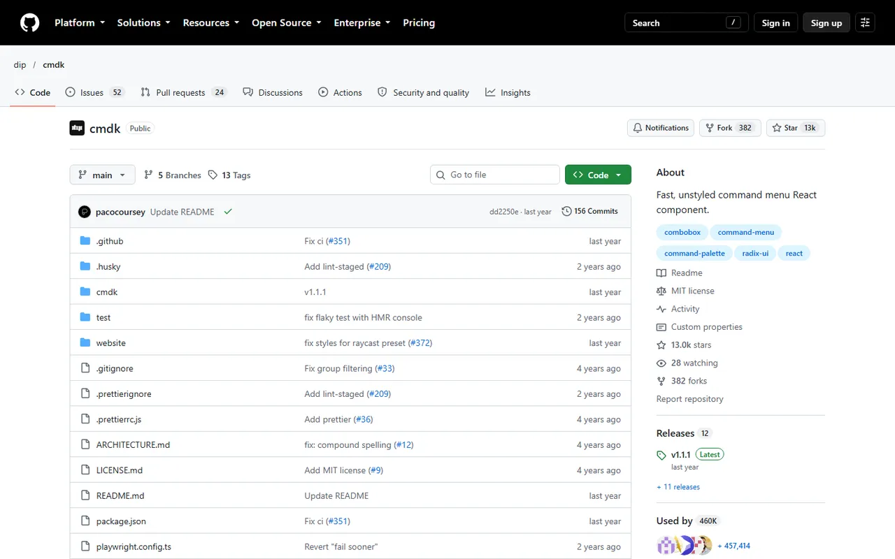
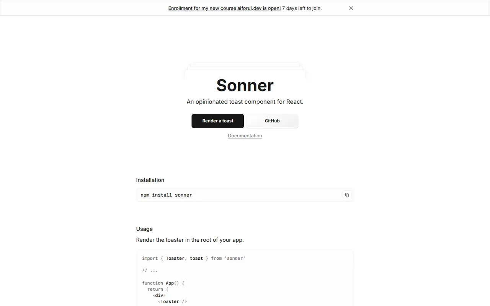
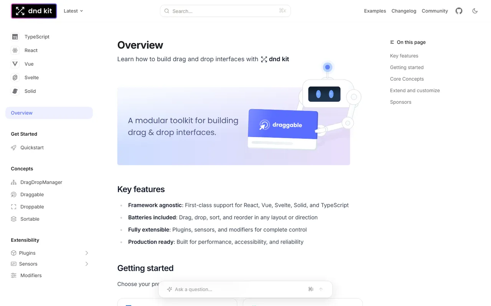
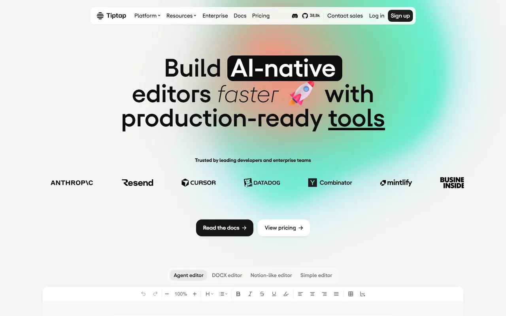
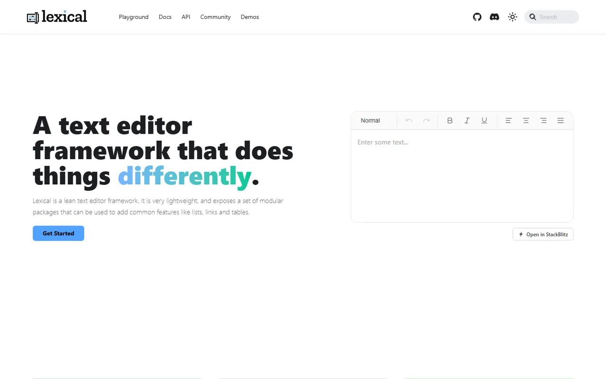
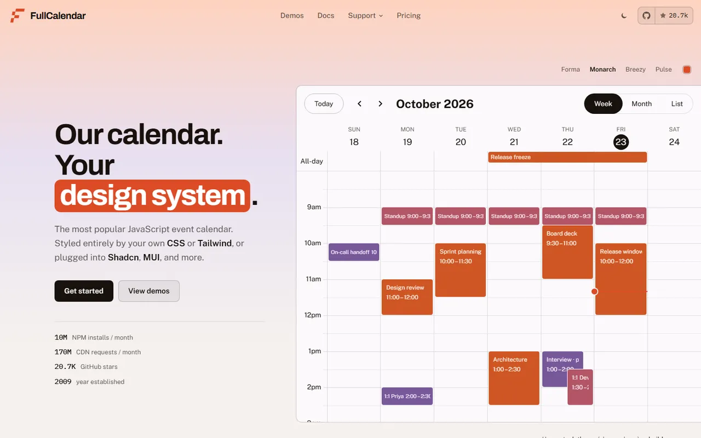
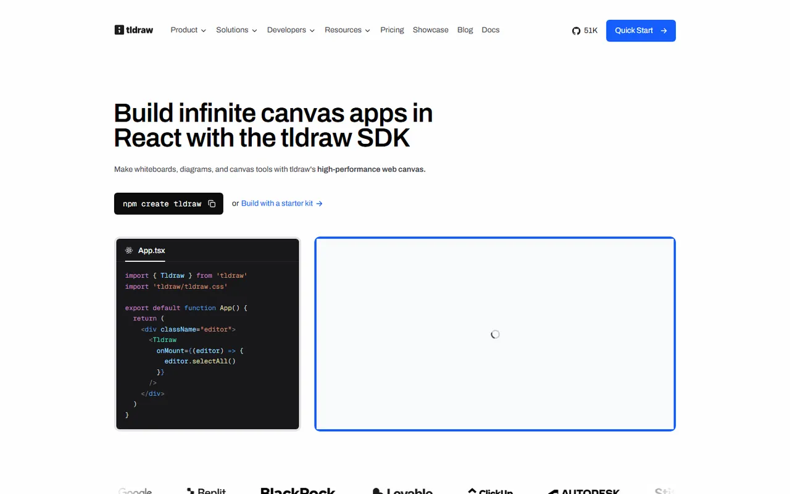
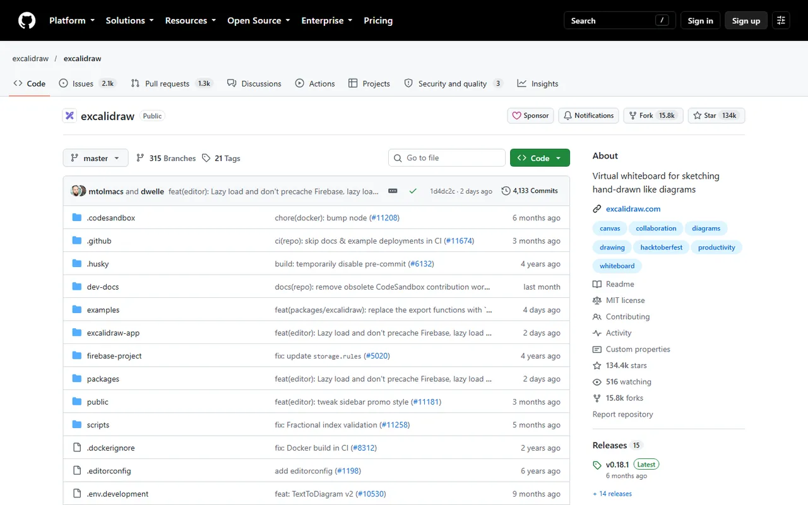

# Specialized Interactive Components - Gallery

[← Back to list](../README.md#specialized-interactive-components) · [All galleries](README.md)

### [cmdk](https://cmdk.paco.me) 🆓⚛️

Fast command menu (⌘K).

---

### [Sonner](https://sonner.emilkowal.ski) 🆓⚛️

Opinionated toast notifications.

---

### [dnd kit](https://dndkit.com) 🆓⚛️

Drag-and-drop toolkit for React.

---

### [Tiptap](https://tiptap.dev) 🆓💎🌐

Headless rich-text editor framework.

---

### [Lexical](https://lexical.dev) 🆓🌐

Meta's extensible text editor.

---

### [AG Grid](https://www.ag-grid.com) 🆓💎🌐

Enterprise data grid.

---

### [FullCalendar](https://fullcalendar.io) 🆓💎🌐

Calendar component.

---

### [tldraw](https://tldraw.dev) 💎⚛️

Infinite canvas SDK.

---

### [Excalidraw](https://github.com/excalidraw/excalidraw) 🆓⚛️

Embeddable hand-drawn whiteboard.

---
