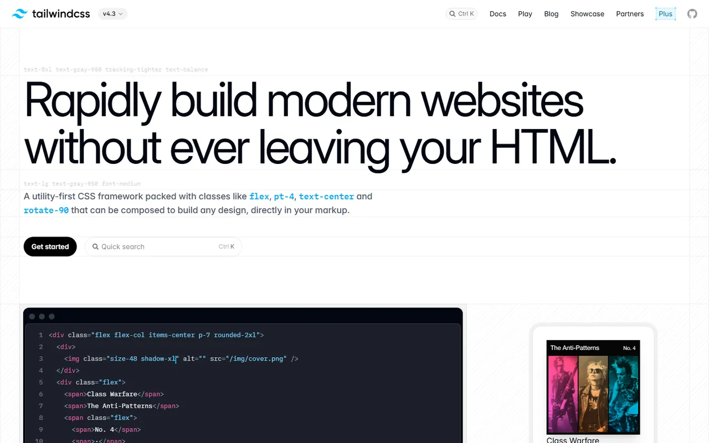
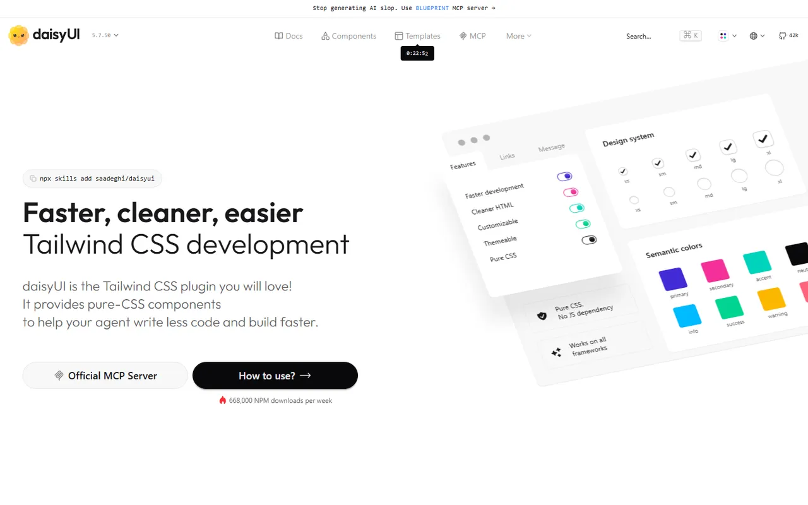
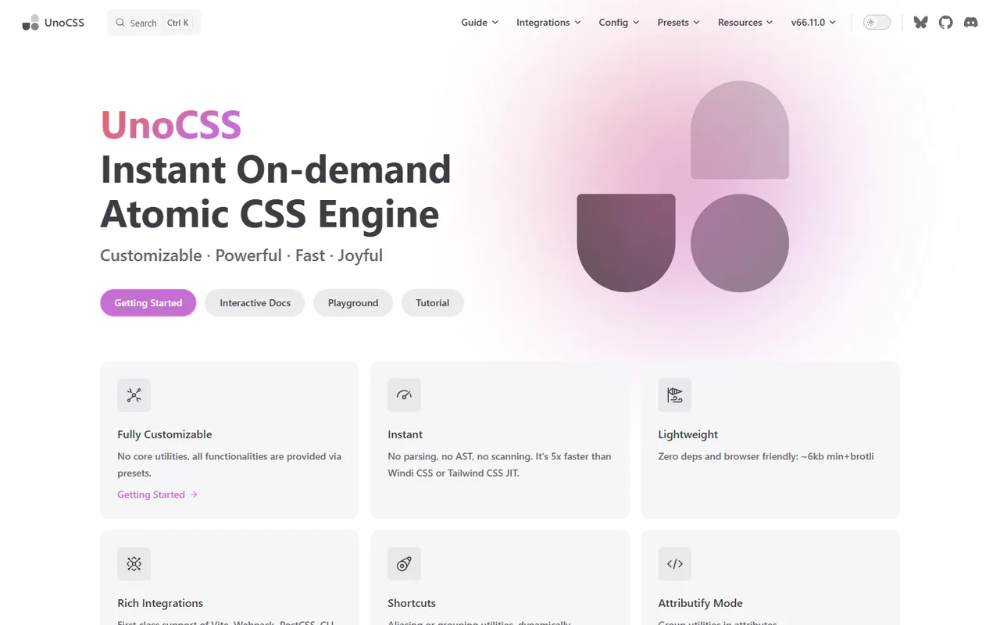
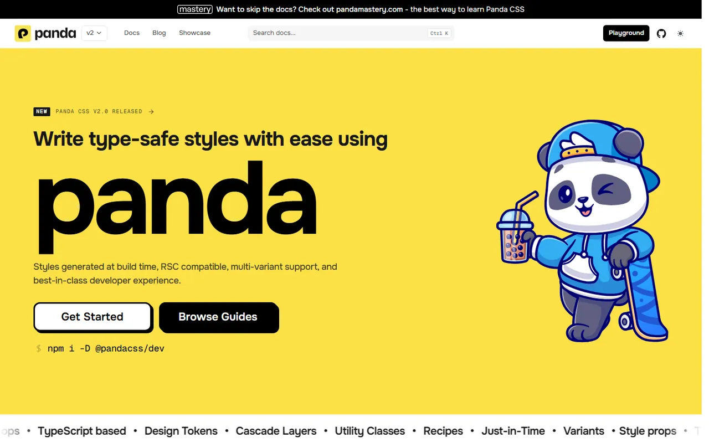
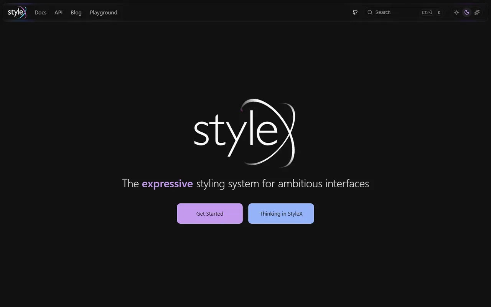
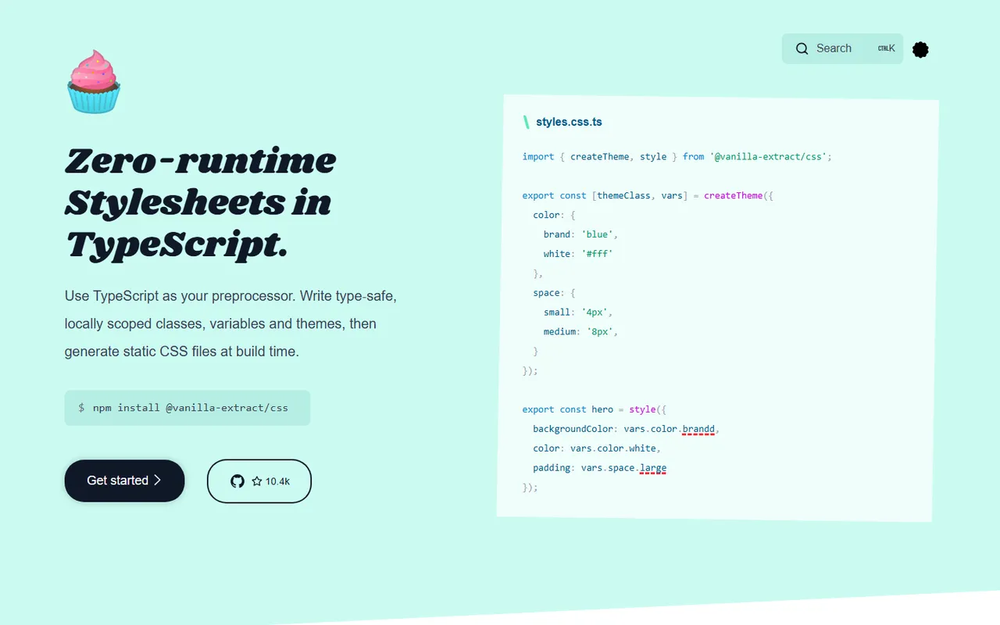
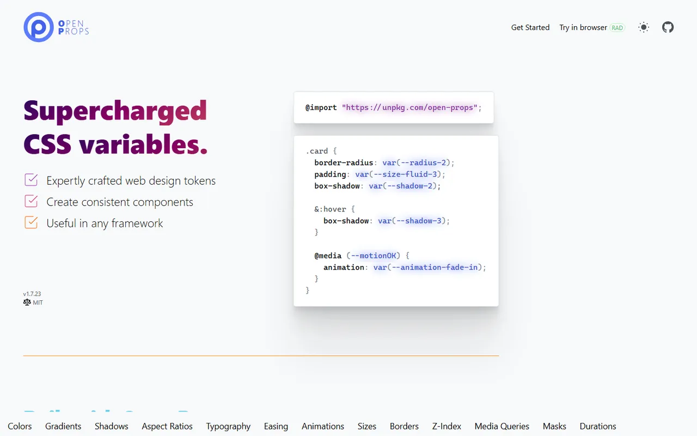
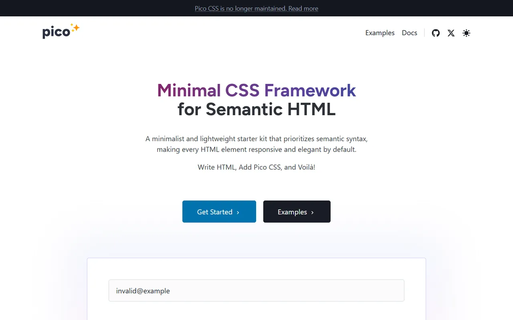
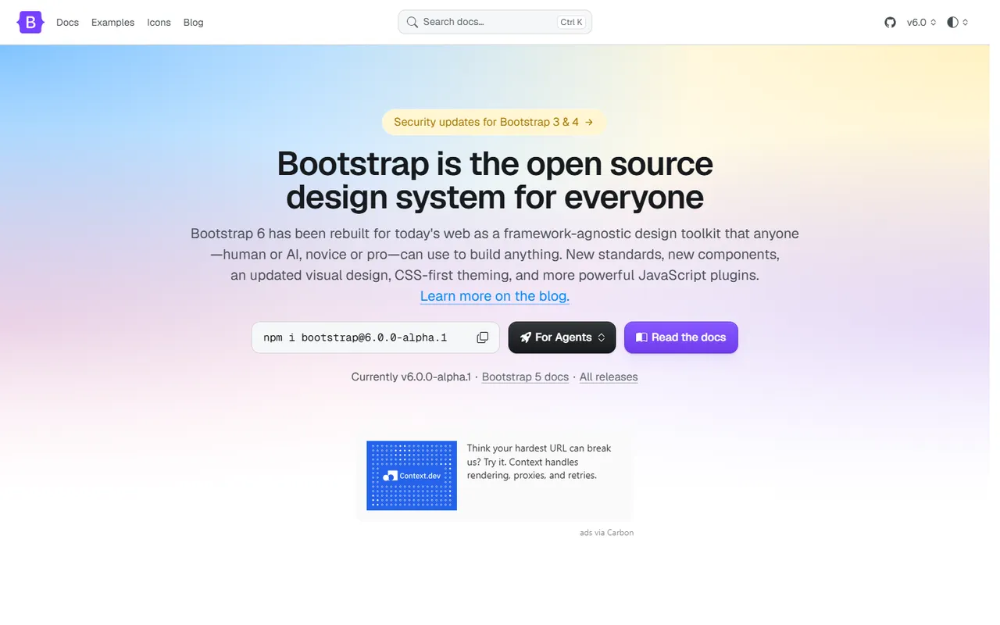
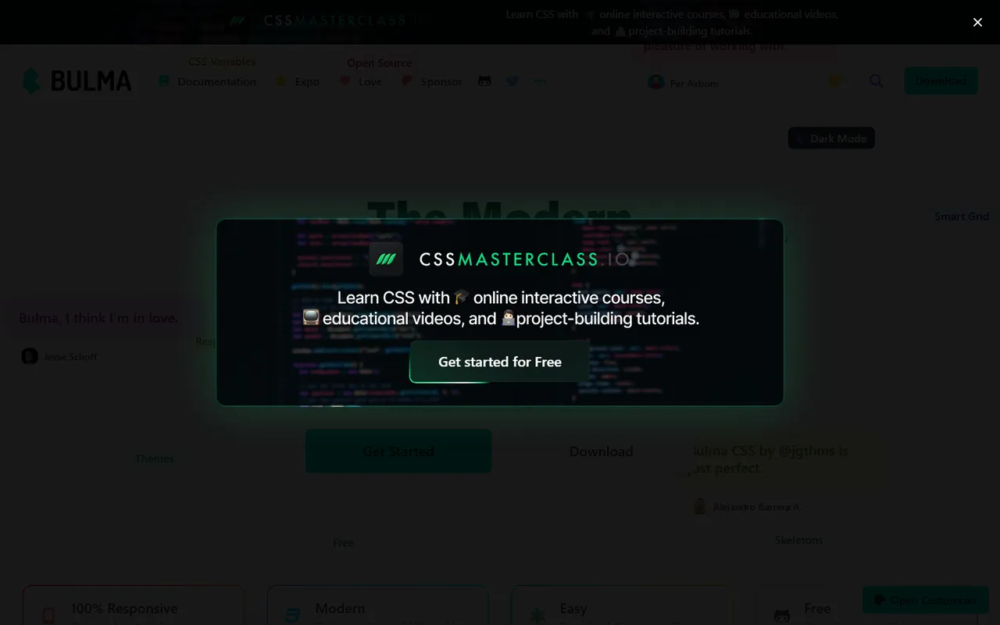

# Styling Foundations - Gallery

[← Back to list](../README.md#styling-foundations) · [All galleries](README.md)

### [Tailwind CSS](https://tailwindcss.com) 🆓🌐

Utility-first CSS framework; the base layer of most modern kits.

---

### [daisyUI](https://daisyui.com) 🆓🌐

Semantic component classes and themes on top of Tailwind.

---

### [UnoCSS](https://unocss.dev) 🆓🌐

Instant on-demand atomic CSS engine.

---

### [Panda CSS](https://panda-css.com) 🆓🌐

Build-time CSS-in-JS with tokens and recipes.

---

### [StyleX](https://stylexjs.com) 🆓⚛️

Meta's compile-time styling system.

---

### [vanilla-extract](https://vanilla-extract.style) 🆓🌐

Zero-runtime, type-safe stylesheets in TypeScript.

---

### [Open Props](https://open-props.style) 🆓🌐

Supercharged CSS custom properties (sizes, easings, shadows).

---

### [Pico CSS](https://picocss.com) 🆓🌐

Minimal CSS for semantic HTML.

---

### [Bootstrap](https://getbootstrap.com) 🆓🌐

The classic responsive component framework.

---

### [Bulma](https://bulma.io) 🆓🌐

Modern, Flexbox-based CSS framework.

---
