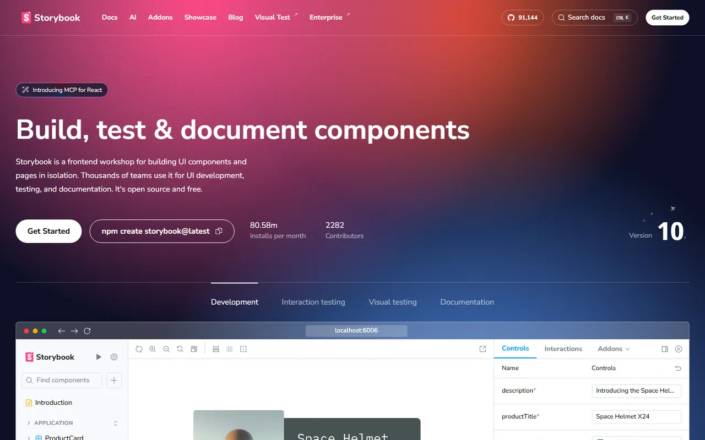
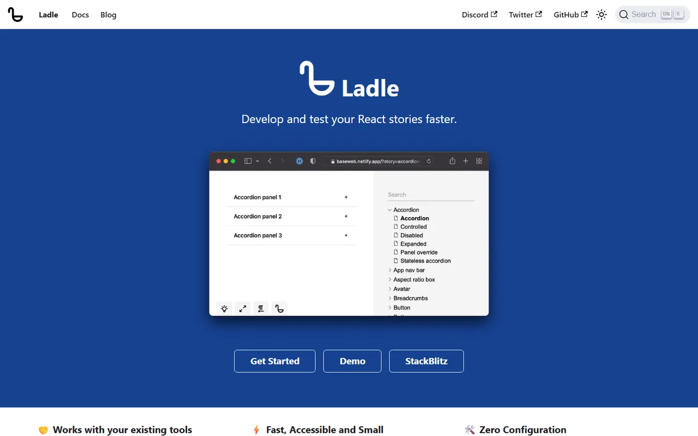
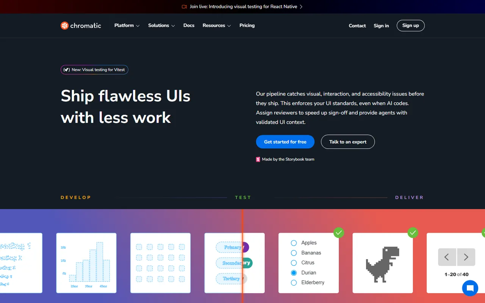
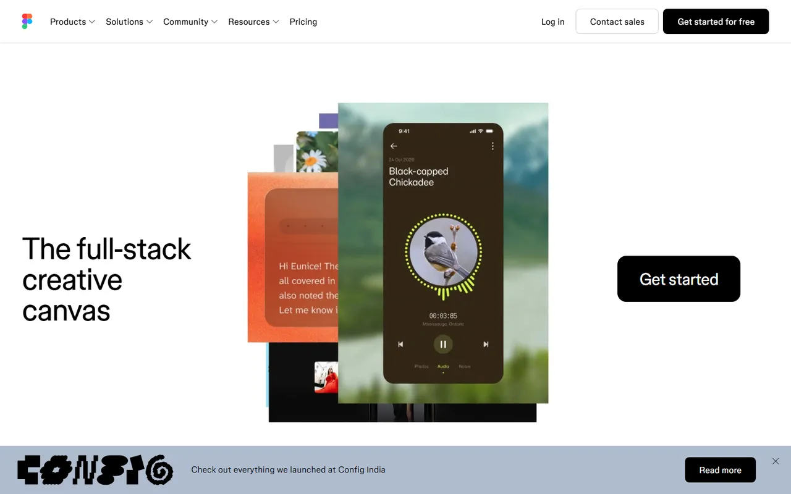
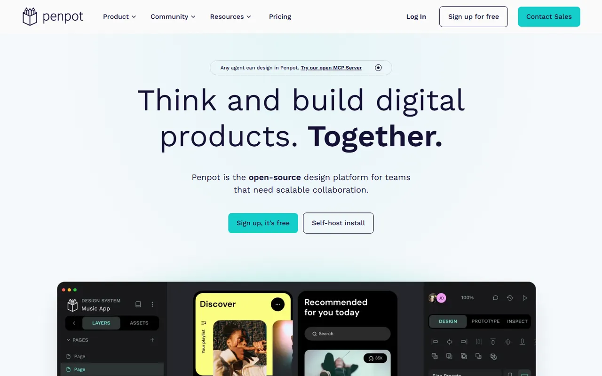
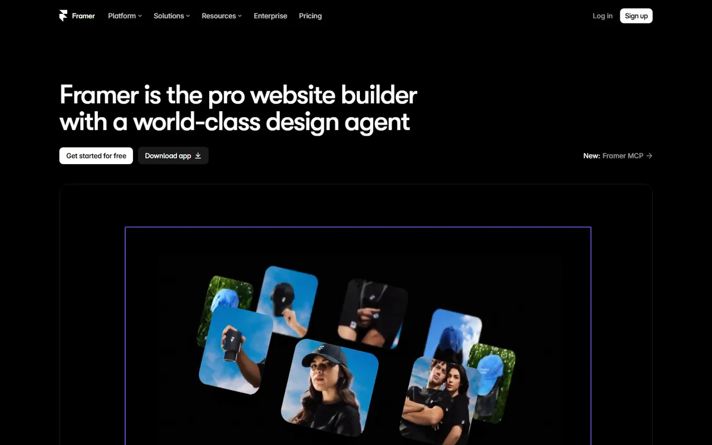
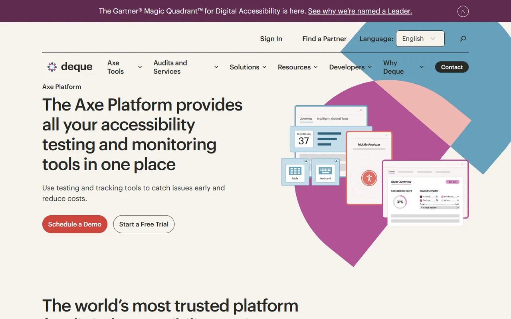

# Tooling & Workflow - Gallery

[← Back to list](../README.md#tooling--workflow) · [All galleries](README.md)

### [Storybook](https://storybook.js.org) 🆓🌐

Build, document and test components in isolation.

---

### [Ladle](https://ladle.dev) 🆓⚛️

Fast Vite-based Storybook alternative.

---

### [Chromatic](https://www.chromatic.com) 🆓💎

Visual regression testing for Storybook.

---

### [Figma](https://www.figma.com) 🆓💎

Design and prototyping.

---

### [Penpot](https://penpot.app) 🆓

Open-source design tool.

---

### [Framer](https://www.framer.com) 🆓💎

Design and publish interactive sites.

---

### [axe DevTools](https://www.deque.com/axe/) 🆓💎

Accessibility testing.

---
